## Naive kernel

```sh
Running kernel 21 on device 0.
Max size: 4096
dimensions(m=n=k) 128, alpha: 0.5, beta: 3
Average elapsed time: (0.000243) s, performance: (   17.3) GFLOPS. size: (128).
dimensions(m=n=k) 256, alpha: 0.5, beta: 3
Average elapsed time: (0.001868) s, performance: (   18.0) GFLOPS. size: (256).
dimensions(m=n=k) 512, alpha: 0.5, beta: 3
Average elapsed time: (0.006513) s, performance: (   41.2) GFLOPS. size: (512).
dimensions(m=n=k) 1024, alpha: 0.5, beta: 3
Average elapsed time: (0.035448) s, performance: (   60.6) GFLOPS. size: (1024).
dimensions(m=n=k) 2048, alpha: 0.5, beta: 3
Average elapsed time: (0.279186) s, performance: (   61.5) GFLOPS. size: (2048).
dimensions(m=n=k) 4096, alpha: 0.5, beta: 3
Average elapsed time: (2.239357) s, performance: (   61.4) GFLOPS. size: (4096).
==PROF== Connected to process 3520 (/content/sgemm/build/sgemm)
Running kernel 21 on device 0.
Max size: 4096
dimensions(m=n=k) 128, alpha: 0.5, beta: 3
Average elapsed time: (0.000384) s, performance: (   10.9) GFLOPS. size: (128).
dimensions(m=n=k) 256, alpha: 0.5, beta: 3
Average elapsed time: (0.001873) s, performance: (   17.9) GFLOPS. size: (256).
dimensions(m=n=k) 512, alpha: 0.5, beta: 3
Average elapsed time: (0.006701) s, performance: (   40.1) GFLOPS. size: (512).
dimensions(m=n=k) 1024, alpha: 0.5, beta: 3
Average elapsed time: (0.035293) s, performance: (   60.8) GFLOPS. size: (1024).
dimensions(m=n=k) 2048, alpha: 0.5, beta: 3
Average elapsed time: (0.278969) s, performance: (   61.6) GFLOPS. size: (2048).
dimensions(m=n=k) 4096, alpha: 0.5, beta: 3
==PROF== Profiling "sgemm_naive_dmalt": 0%..
==WARNING== Launching the workload is taking more time than expected. If this continues to hang, terminate the profile and re-try by profiling the range of all related launches using '--replay-mode range'. See https://docs.nvidia.com/nsight-compute/ProfilingGuide/index.html#replay for more details.
..50%....100% - 8 passes
Average elapsed time: (3.242528) s, performance: (   42.4) GFLOPS. size: (4096).
==PROF== Disconnected from process 3520
[3520] sgemm@127.0.0.1
  sgemm_naive_dmalt(int, int, int, float, const float *, const float *, float, float *) (128, 128, 1)x(32, 32, 1), Context 1, Stream 7, Device 0, CC 7.5
    Section: GPU Speed Of Light Throughput
    ----------------------- ----------- ----------------
    Metric Name             Metric Unit     Metric Value
    ----------------------- ----------- ----------------
    DRAM Frequency                  Ghz             5.00
    SM Frequency                    Mhz           585.00
    Elapsed Cycles                cycle    3,548,923,287
    Memory Throughput                 %            49.95
    DRAM Throughput                   %             0.93
    Duration                          s             6.07
    L1/TEX Cache Throughput           %            99.90
    L2 Cache Throughput               %             1.17
    SM Active Cycles              cycle 3,543,922,046.38
    Compute (SM) Throughput           %             6.05
    ----------------------- ----------- ----------------

    OPT   This workload exhibits low compute throughput and memory bandwidth utilization relative to the peak
          performance of this device. Achieved compute throughput and/or memory bandwidth below 60.0% of peak
          typically indicate latency issues. Look at Scheduler Statistics and Warp State Statistics for potential
          reasons.

    Section: Memory Workload Analysis
    ----------------- ----------- ------------
    Metric Name       Metric Unit Metric Value
    ----------------- ----------- ------------
    Memory Throughput     Gbyte/s         2.98
    Mem Busy                    %        49.95
    Max Bandwidth               %        13.85
    L1/TEX Hit Rate             %        97.32
    L2 Hit Rate                 %        92.61
    Mem Pipes Busy              %         6.05
    ----------------- ----------- ------------
```

## Coalescing kernel

### Indswap

```sh
Running kernel 22 on device 0.
Max size: 4096
dimensions(m=n=k) 128, alpha: 0.5, beta: 3
Average elapsed time: (0.000036) s, performance: (  115.1) GFLOPS. size: (128).
dimensions(m=n=k) 256, alpha: 0.5, beta: 3
Average elapsed time: (0.000140) s, performance: (  239.4) GFLOPS. size: (256).
dimensions(m=n=k) 512, alpha: 0.5, beta: 3
Average elapsed time: (0.000946) s, performance: (  283.9) GFLOPS. size: (512).
dimensions(m=n=k) 1024, alpha: 0.5, beta: 3
Average elapsed time: (0.005653) s, performance: (  379.9) GFLOPS. size: (1024).
dimensions(m=n=k) 2048, alpha: 0.5, beta: 3
Average elapsed time: (0.037434) s, performance: (  458.9) GFLOPS. size: (2048).
dimensions(m=n=k) 4096, alpha: 0.5, beta: 3
Average elapsed time: (0.307420) s, performance: (  447.1) GFLOPS. size: (4096).

$ ncu --kernel-name sgemm_coalesce_indswap_dmalt \
    --launch-skip 256 --launch-count 1 \
    --section SpeedOfLight --section MemoryWorkloadAnalysis \
    ./sgemm/build/sgemm 22
==PROF== Connected to process 4812 (/content/sgemm/build/sgemm)
Running kernel 22 on device 0.
Max size: 4096
dimensions(m=n=k) 128, alpha: 0.5, beta: 3
Average elapsed time: (0.000574) s, performance: (    7.3) GFLOPS. size: (128).
dimensions(m=n=k) 256, alpha: 0.5, beta: 3
Average elapsed time: (0.000495) s, performance: (   67.8) GFLOPS. size: (256).
dimensions(m=n=k) 512, alpha: 0.5, beta: 3
Average elapsed time: (0.000956) s, performance: (  280.9) GFLOPS. size: (512).
dimensions(m=n=k) 1024, alpha: 0.5, beta: 3
Average elapsed time: (0.005545) s, performance: (  387.3) GFLOPS. size: (1024).
dimensions(m=n=k) 2048, alpha: 0.5, beta: 3
Average elapsed time: (0.037633) s, performance: (  456.5) GFLOPS. size: (2048).
dimensions(m=n=k) 4096, alpha: 0.5, beta: 3
==PROF== Profiling "sgemm_coalesce_indswap_dmalt": 0%....50%....100% - 8 passes
Average elapsed time: (0.432565) s, performance: (  317.7) GFLOPS. size: (4096).
==PROF== Disconnected from process 4812
[4812] sgemm@127.0.0.1
  sgemm_coalesce_indswap_dmalt(int, int, int, float, const float *, const float *, float, float *) (128, 128, 1)x(32, 32, 1), Context 1, Stream 7, Device 0, CC 7.5
    Section: GPU Speed Of Light Throughput
    ----------------------- ----------- --------------
    Metric Name             Metric Unit   Metric Value
    ----------------------- ----------- --------------
    DRAM Frequency                  Ghz           5.00
    SM Frequency                    Mhz         585.00
    Elapsed Cycles                cycle    276,609,087
    Memory Throughput                 %          77.68
    DRAM Throughput                   %           8.84
    Duration                         ms         472.84
    L1/TEX Cache Throughput           %          77.79
    L2 Cache Throughput               %           4.18
    SM Active Cycles              cycle 276,184,847.43
    Compute (SM) Throughput           %          77.68
    ----------------------- ----------- --------------

    INF   Compute and Memory are well-balanced: To reduce runtime, both computation and memory traffic must be reduced.
          Check both the Compute Workload Analysis and Memory Workload Analysis sections.

    Section: Memory Workload Analysis
    ----------------- ----------- ------------
    Metric Name       Metric Unit Metric Value
    ----------------- ----------- ------------
    Memory Throughput     Gbyte/s        28.25
    Mem Busy                    %        38.84
    Max Bandwidth               %        77.68
    L1/TEX Hit Rate             %        94.98
    L2 Hit Rate                 %        49.56
    Mem Pipes Busy              %        77.68
    ----------------- ----------- ------------
```

### Flat block (Boehm's version)

```sh
``Running kernel 23 on device 0.
Max size: 4096
dimensions(m=n=k) 128, alpha: 0.5, beta: 3
Average elapsed time: (0.000037) s, performance: (  113.6) GFLOPS. size: (128).
dimensions(m=n=k) 256, alpha: 0.5, beta: 3
Average elapsed time: (0.000142) s, performance: (  236.7) GFLOPS. size: (256).
dimensions(m=n=k) 512, alpha: 0.5, beta: 3
Average elapsed time: (0.000957) s, performance: (  280.6) GFLOPS. size: (512).
dimensions(m=n=k) 1024, alpha: 0.5, beta: 3
Average elapsed time: (0.005029) s, performance: (  427.0) GFLOPS. size: (1024).
dimensions(m=n=k) 2048, alpha: 0.5, beta: 3
Average elapsed time: (0.034065) s, performance: (  504.3) GFLOPS. size: (2048).
dimensions(m=n=k) 4096, alpha: 0.5, beta: 3
Average elapsed time: (0.277539) s, performance: (  495.2) GFLOPS. size: (4096).`

$ ncu --kernel-name sgemm_coalesce_dmalt \
    --launch-skip 256 --launch-count 1 \
    --section SpeedOfLight --section MemoryWorkloadAnalysis \
    ./sgemm/build/sgemm 23
==PROF== Connected to process 6084 (/content/sgemm/build/sgemm)
Running kernel 23 on device 0.
Max size: 4096
dimensions(m=n=k) 128, alpha: 0.5, beta: 3
Average elapsed time: (0.000374) s, performance: (   11.2) GFLOPS. size: (128).
dimensions(m=n=k) 256, alpha: 0.5, beta: 3
Average elapsed time: (0.000410) s, performance: (   81.8) GFLOPS. size: (256).
dimensions(m=n=k) 512, alpha: 0.5, beta: 3
Average elapsed time: (0.000965) s, performance: (  278.3) GFLOPS. size: (512).
dimensions(m=n=k) 1024, alpha: 0.5, beta: 3
Average elapsed time: (0.005730) s, performance: (  374.8) GFLOPS. size: (1024).
dimensions(m=n=k) 2048, alpha: 0.5, beta: 3
Average elapsed time: (0.035210) s, performance: (  487.9) GFLOPS. size: (2048).
dimensions(m=n=k) 4096, alpha: 0.5, beta: 3
==PROF== Profiling "sgemm_coalesce_dmalt": 0%....50%....100% - 8 passes
Average elapsed time: (0.403874) s, performance: (  340.3) GFLOPS. size: (4096).
==PROF== Disconnected from process 6084
[6084] sgemm@127.0.0.1
  void sgemm_coalesce_dmalt<32>(int, int, int, float, const float *, const float *, float, float *) (128, 128, 1)x(1024, 1, 1), Context 1, Stream 7, Device 0, CC 7.5
    Section: GPU Speed Of Light Throughput
    ----------------------- ----------- --------------
    Metric Name             Metric Unit   Metric Value
    ----------------------- ----------- --------------
    DRAM Frequency                  Ghz           5.00
    SM Frequency                    Mhz         585.00
    Elapsed Cycles                cycle    269,329,911
    Memory Throughput                 %          79.78
    DRAM Throughput                   %          12.05
    Duration                         ms         460.39
    L1/TEX Cache Throughput           %          79.87
    L2 Cache Throughput               %           4.30
    SM Active Cycles              cycle 268,970,023.02
    Compute (SM) Throughput           %          79.78
    ----------------------- ----------- --------------

    INF   Compute and Memory are well-balanced: To reduce runtime, both computation and memory traffic must be reduced.
          Check both the Compute Workload Analysis and Memory Workload Analysis sections.

    Section: Memory Workload Analysis
    ----------------- ----------- ------------
    Metric Name       Metric Unit Metric Value
    ----------------- ----------- ------------
    Memory Throughput     Gbyte/s        38.51
    Mem Busy                    %        39.89
    Max Bandwidth               %        79.78
    L1/TEX Hit Rate             %        94.98
    L2 Hit Rate                 %        73.25
    Mem Pipes Busy              %        79.78
    ----------------- ----------- ------------
```

## Tiling

```sh
Running kernel 25 on device 0.
Max size: 4096
dimensions(m=n=k) 128, alpha: 0.5, beta: 3
Average elapsed time: (0.000026) s, performance: (  162.9) GFLOPS. size: (128).
dimensions(m=n=k) 256, alpha: 0.5, beta: 3
Average elapsed time: (0.000106) s, performance: (  315.5) GFLOPS. size: (256).
dimensions(m=n=k) 512, alpha: 0.5, beta: 3
Average elapsed time: (0.000703) s, performance: (  381.6) GFLOPS. size: (512).
dimensions(m=n=k) 1024, alpha: 0.5, beta: 3
Average elapsed time: (0.003994) s, performance: (  537.7) GFLOPS. size: (1024).
dimensions(m=n=k) 2048, alpha: 0.5, beta: 3
Average elapsed time: (0.019648) s, performance: (  874.4) GFLOPS. size: (2048).
dimensions(m=n=k) 4096, alpha: 0.5, beta: 3
Average elapsed time: (0.158643) s, performance: (  866.3) GFLOPS. size: (4096).
==PROF== Connected to process 7586 (/content/sgemm/build/sgemm)
Running kernel 25 on device 0.
Max size: 4096
dimensions(m=n=k) 128, alpha: 0.5, beta: 3
Average elapsed time: (0.000470) s, performance: (    8.9) GFLOPS. size: (128).
dimensions(m=n=k) 256, alpha: 0.5, beta: 3
Average elapsed time: (0.000405) s, performance: (   82.9) GFLOPS. size: (256).
dimensions(m=n=k) 512, alpha: 0.5, beta: 3
Average elapsed time: (0.000712) s, performance: (  377.2) GFLOPS. size: (512).
dimensions(m=n=k) 1024, alpha: 0.5, beta: 3
Average elapsed time: (0.003883) s, performance: (  553.0) GFLOPS. size: (1024).
dimensions(m=n=k) 2048, alpha: 0.5, beta: 3
Average elapsed time: (0.019745) s, performance: (  870.1) GFLOPS. size: (2048).
dimensions(m=n=k) 4096, alpha: 0.5, beta: 3
==PROF== Profiling "sgemm_shared_mem_block_dmalt": 0%....50%....100% - 8 passes
Average elapsed time: (0.257308) s, performance: (  534.1) GFLOPS. size: (4096).
==PROF== Disconnected from process 7586
[7586] sgemm@127.0.0.1
  void sgemm_shared_mem_block_dmalt<32>(int, int, int, float, const float *, const float *, float, float *) (128, 128, 1)x(1024, 1, 1), Context 1, Stream 7, Device 0, CC 7.5
    Section: GPU Speed Of Light Throughput
    ----------------------- ----------- --------------
    Metric Name             Metric Unit   Metric Value
    ----------------------- ----------- --------------
    DRAM Frequency                  Ghz           5.00
    SM Frequency                    Mhz         585.00
    Elapsed Cycles                cycle    193,749,779
    Memory Throughput                 %          76.23
    DRAM Throughput                   %          12.90
    Duration                         ms         331.20
    L1/TEX Cache Throughput           %          90.41
    L2 Cache Throughput               %           5.97
    SM Active Cycles              cycle 193,488,364.88
    Compute (SM) Throughput           %          76.23
    ----------------------- ----------- --------------

    INF   Compute and Memory are well-balanced: To reduce runtime, both computation and memory traffic must be reduced.
          Check both the Compute Workload Analysis and Memory Workload Analysis sections.

    Section: Memory Workload Analysis
    ----------------- ----------- ------------
    Metric Name       Metric Unit Metric Value
    ----------------- ----------- ------------
    Memory Throughput     Gbyte/s        41.24
    Mem Busy                    %        45.21
    Max Bandwidth               %        76.23
    L1/TEX Hit Rate             %         0.39
    L2 Hit Rate                 %        47.36
    Mem Pipes Busy              %        76.23
    ----------------- ----------- ------------

```

## 1D blocktiling

```sh
Running kernel 26 on device 0.
Max size: 4096
dimensions(m=n=k) 128, alpha: 0.5, beta: 3
Average elapsed time: (0.000044) s, performance: (   95.3) GFLOPS. size: (128).
dimensions(m=n=k) 256, alpha: 0.5, beta: 3
Average elapsed time: (0.000081) s, performance: (  413.7) GFLOPS. size: (256).
dimensions(m=n=k) 512, alpha: 0.5, beta: 3
Average elapsed time: (0.000368) s, performance: (  728.6) GFLOPS. size: (512).
dimensions(m=n=k) 1024, alpha: 0.5, beta: 3
Average elapsed time: (0.002567) s, performance: (  836.6) GFLOPS. size: (1024).
dimensions(m=n=k) 2048, alpha: 0.5, beta: 3
Average elapsed time: (0.009488) s, performance: ( 1810.6) GFLOPS. size: (2048).
dimensions(m=n=k) 4096, alpha: 0.5, beta: 3
Average elapsed time: (0.071322) s, performance: ( 1927.0) GFLOPS. size: (4096).

==PROF== Connected to process 1807 (/content/sgemm/build/sgemm)
Running kernel 26 on device 0.
Max size: 4096
dimensions(m=n=k) 128, alpha: 0.5, beta: 3
Average elapsed time: (0.000486) s, performance: (    8.6) GFLOPS. size: (128).
dimensions(m=n=k) 256, alpha: 0.5, beta: 3
Average elapsed time: (0.000512) s, performance: (   65.5) GFLOPS. size: (256).
dimensions(m=n=k) 512, alpha: 0.5, beta: 3
Average elapsed time: (0.000531) s, performance: (  505.8) GFLOPS. size: (512).
dimensions(m=n=k) 1024, alpha: 0.5, beta: 3
Average elapsed time: (0.002575) s, performance: (  834.0) GFLOPS. size: (1024).
dimensions(m=n=k) 2048, alpha: 0.5, beta: 3
Average elapsed time: (0.009757) s, performance: ( 1760.8) GFLOPS. size: (2048).
dimensions(m=n=k) 4096, alpha: 0.5, beta: 3
==PROF== Profiling "sgemm1DBlocktilingDmalt": 0%....50%....100% - 8 passes
Average elapsed time: (0.144498) s, performance: (  951.1) GFLOPS. size: (4096).
==PROF== Disconnected from process 1807
[1807] sgemm@127.0.0.1
  void sgemm1DBlocktilingDmalt<64, 64, 8, 8>(int, int, int, float, const float *, const float *, float, float *) (64, 64, 1)x(512, 1, 1), Context 1, Stream 7, Device 0, CC 7.5
    Section: GPU Speed Of Light Throughput
    ----------------------- ----------- -------------
    Metric Name             Metric Unit  Metric Value
    ----------------------- ----------- -------------
    DRAM Frequency                  Ghz          5.00
    SM Frequency                    Mhz        585.00
    Elapsed Cycles                cycle    86,897,823
    Memory Throughput                 %         54.12
    DRAM Throughput                   %         13.09
    Duration                         ms        148.54
    L1/TEX Cache Throughput           %         91.54
    L2 Cache Throughput               %          6.71
    SM Active Cycles              cycle 86,380,004.95
    Compute (SM) Throughput           %         54.12
    ----------------------- ----------- -------------

    OPT   This workload exhibits low compute throughput and memory bandwidth utilization relative to the peak
          performance of this device. Achieved compute throughput and/or memory bandwidth below 60.0% of peak
          typically indicate latency issues. Look at Scheduler Statistics and Warp State Statistics for potential
          reasons.

    Section: Memory Workload Analysis
    ----------------- ----------- ------------
    Metric Name       Metric Unit Metric Value
    ----------------- ----------- ------------
    Memory Throughput     Gbyte/s        41.85
    Mem Busy                    %        45.77
    Max Bandwidth               %        54.12
    L1/TEX Hit Rate             %         0.77
    L2 Hit Rate                 %        49.07
    Mem Pipes Busy              %        54.12
    ----------------- ----------- ------------
```

## 2D blocktiling

```sh
Running kernel 27 on device 0.
Max size: 4096
dimensions(m=n=k) 128, alpha: 0.5, beta: 3
Average elapsed time: (0.000116) s, performance: (   36.3) GFLOPS. size: (128).
dimensions(m=n=k) 256, alpha: 0.5, beta: 3
Average elapsed time: (0.000196) s, performance: (  170.9) GFLOPS. size: (256).
dimensions(m=n=k) 512, alpha: 0.5, beta: 3
Average elapsed time: (0.000359) s, performance: (  748.5) GFLOPS. size: (512).
dimensions(m=n=k) 1024, alpha: 0.5, beta: 3
Average elapsed time: (0.001441) s, performance: ( 1490.0) GFLOPS. size: (1024).
dimensions(m=n=k) 2048, alpha: 0.5, beta: 3
Average elapsed time: (0.005598) s, performance: ( 3069.1) GFLOPS. size: (2048).
dimensions(m=n=k) 4096, alpha: 0.5, beta: 3
Average elapsed time: (0.040126) s, performance: ( 3425.2) GFLOPS. size: (4096).

==PROF== Connected to process 3430 (/content/sgemm/build/sgemm)
Running kernel 27 on device 0.
Max size: 4096
dimensions(m=n=k) 128, alpha: 0.5, beta: 3
Average elapsed time: (0.000439) s, performance: (    9.5) GFLOPS. size: (128).
dimensions(m=n=k) 256, alpha: 0.5, beta: 3
Average elapsed time: (0.000377) s, performance: (   89.1) GFLOPS. size: (256).
dimensions(m=n=k) 512, alpha: 0.5, beta: 3
Average elapsed time: (0.000378) s, performance: (  709.6) GFLOPS. size: (512).
dimensions(m=n=k) 1024, alpha: 0.5, beta: 3
Average elapsed time: (0.001598) s, performance: ( 1343.6) GFLOPS. size: (1024).
dimensions(m=n=k) 2048, alpha: 0.5, beta: 3
Average elapsed time: (0.005671) s, performance: ( 3029.2) GFLOPS. size: (2048).
dimensions(m=n=k) 4096, alpha: 0.5, beta: 3
==PROF== Profiling "sgemm2DBlocktilingDmalt": 0%....50%....100% - 8 passes
Average elapsed time: (0.099048) s, performance: ( 1387.6) GFLOPS. size: (4096).
==PROF== Disconnected from process 3430
[3430] sgemm@127.0.0.1
  void sgemm2DBlocktilingDmalt<128, 128, 8, 8, 8>(int, int, int, float, const float *, const float *, float, float *) (32, 32, 1)x(256, 1, 1), Context 1, Stream 7, Device 0, CC 7.5
    Section: GPU Speed Of Light Throughput
    ----------------------- ----------- -------------
    Metric Name             Metric Unit  Metric Value
    ----------------------- ----------- -------------
    DRAM Frequency                  Ghz          4.99
    SM Frequency                    Mhz        585.00
    Elapsed Cycles                cycle    44,701,799
    Memory Throughput                 %         48.53
    DRAM Throughput                   %         12.76
    Duration                         ms         76.41
    L1/TEX Cache Throughput           %         97.07
    L2 Cache Throughput               %          7.22
    SM Active Cycles              cycle 43,939,572.20
    Compute (SM) Throughput           %         61.37
    ----------------------- ----------- -------------

    OPT   Compute is more heavily utilized than Memory: Look at the Compute Workload Analysis section to see what the
          compute pipelines are spending their time doing. Also, consider whether any computation is redundant and
          could be reduced or moved to look-up tables.

    Section: Memory Workload Analysis
    ----------------- ----------- ------------
    Metric Name       Metric Unit Metric Value
    ----------------- ----------- ------------
    Memory Throughput     Gbyte/s        40.76
    Mem Busy                    %        48.53
    Max Bandwidth               %        26.39
    L1/TEX Hit Rate             %        18.80
    L2 Hit Rate                 %        57.42
    Mem Pipes Busy              %        26.39
    ----------------- ----------- ------------
```

## Vectorize

```sh
Running kernel 28 on device 0.
Max size: 4096
dimensions(m=n=k) 128, alpha: 0.5, beta: 3
Average elapsed time: (0.000094) s, performance: (   44.8) GFLOPS. size: (128).
dimensions(m=n=k) 256, alpha: 0.5, beta: 3
Average elapsed time: (0.000172) s, performance: (  195.4) GFLOPS. size: (256).
dimensions(m=n=k) 512, alpha: 0.5, beta: 3
Average elapsed time: (0.000328) s, performance: (  819.0) GFLOPS. size: (512).
dimensions(m=n=k) 1024, alpha: 0.5, beta: 3
Average elapsed time: (0.001346) s, performance: ( 1595.3) GFLOPS. size: (1024).
dimensions(m=n=k) 2048, alpha: 0.5, beta: 3
Average elapsed time: (0.005472) s, performance: ( 3139.7) GFLOPS. size: (2048).
dimensions(m=n=k) 4096, alpha: 0.5, beta: 3
Average elapsed time: (0.036921) s, performance: ( 3722.5) GFLOPS. size: (4096).
==PROF== Connected to process 4925 (/content/sgemm/build/sgemm)
Running kernel 28 on device 0.
Max size: 4096
dimensions(m=n=k) 128, alpha: 0.5, beta: 3
Average elapsed time: (0.000431) s, performance: (    9.7) GFLOPS. size: (128).
dimensions(m=n=k) 256, alpha: 0.5, beta: 3
Average elapsed time: (0.000397) s, performance: (   84.5) GFLOPS. size: (256).
dimensions(m=n=k) 512, alpha: 0.5, beta: 3
Average elapsed time: (0.000576) s, performance: (  465.7) GFLOPS. size: (512).
dimensions(m=n=k) 1024, alpha: 0.5, beta: 3
Average elapsed time: (0.001431) s, performance: ( 1500.2) GFLOPS. size: (1024).
dimensions(m=n=k) 2048, alpha: 0.5, beta: 3
Average elapsed time: (0.005443) s, performance: ( 3156.3) GFLOPS. size: (2048).
dimensions(m=n=k) 4096, alpha: 0.5, beta: 3
==PROF== Profiling "sgemmVectorizeDmalt": 0%....50%....100% - 8 passes
Average elapsed time: (0.095558) s, performance: ( 1438.3) GFLOPS. size: (4096).
==PROF== Disconnected from process 4925
[4925] sgemm@127.0.0.1
  void sgemmVectorizeDmalt<128, 128, 8, 8, 8>(int, int, int, float, float *, float *, float, float *) (32, 32, 1)x(256, 1, 1), Context 1, Stream 7, Device 0, CC 7.5
    Section: GPU Speed Of Light Throughput
    ----------------------- ----------- -------------
    Metric Name             Metric Unit  Metric Value
    ----------------------- ----------- -------------
    DRAM Frequency                  Ghz          5.00
    SM Frequency                    Mhz        585.00
    Elapsed Cycles                cycle    41,577,791
    Memory Throughput                 %         48.76
    DRAM Throughput                   %         10.27
    Duration                         ms         71.07
    L1/TEX Cache Throughput           %         97.52
    L2 Cache Throughput               %          7.22
    SM Active Cycles              cycle 40,886,968.58
    Compute (SM) Throughput           %         65.22
    ----------------------- ----------- -------------

    OPT   Compute is more heavily utilized than Memory: Look at the Compute Workload Analysis section to see what the
          compute pipelines are spending their time doing. Also, consider whether any computation is redundant and
          could be reduced or moved to look-up tables.

    Section: Memory Workload Analysis
    ----------------- ----------- ------------
    Metric Name       Metric Unit Metric Value
    ----------------- ----------- ------------
    Memory Throughput     Gbyte/s        32.83
    Mem Busy                    %        48.76
    Max Bandwidth               %        26.32
    L1/TEX Hit Rate             %         4.42
    L2 Hit Rate                 %        60.10
    Mem Pipes Busy              %        19.70
    ----------------- ----------- ------------
```

## Comparison

| Kernel name                  | 4096 GFLOPS | Mem TP 1 | DRAM TP | L1 TP | L2 TP | Compute TP | Mem TP 2 | Mem Busy | Max BW | L1 HR | L2 HR | Mem Pipes Busy |
| ---------------------------- | ----------- | -------- | ------- | ----- | ----- | ---------- | -------- | -------- | ------ | ----- | ----- | -------------- |
| sgemm_naive_dmalt            | 61.4        | 49.95    | 0.93    | 99.9  | 1.17  | 6.05       | 2.98     | 49.95    | 13.85  | 97.32 | 92.61 | 6.05           |
| sgemm_coalesce_indswap_dmalt | 447.1       | 77.68    | 8.84    | 77.79 | 4.18  | 77.68      | 28.25    | 38.84    | 77.68  | 94.98 | 49.56 | 77.68          |
| sgemm_coalesce_dmalt         | 495.2       | 79.78    | 12.05   | 79.87 | 4.30  | 79.78      | 38.51    | 39.89    | 79.78  | 94.98 | 73.25 | 79.78          |
| sgemm_shared_mem_block_dmalt | 866.3       | 76.23    | 12.90   | 90.41 | 5.97  | 76.23      | 41.24    | 45.21    | 76.23  | 0.39  | 47.36 | 76.23          |
| gemm_1d_blocktiling          | 1927.0      | 54.1     | 13.09   | 91.54 | 6.71  | 54.12      | 41.85    | 45.77    | 54.12  | 0.77  | 49.07 | 54.12          |
| gemm_2d_blocktiling          | 3425.2      | 48.53    | 12.76   | 97.07 | 7.22  | 61.37      | 40.76    | 48.53    | 26.39  | 18.80 | 57.42 | 26.39          |
| gemm_vectorize               | 3722.5      | 48.76    | 10.27   | 97.52 | 7.22  | 65.22      | 32.83    | 48.76    | 26.32  | 4.42  | 60.10 | 19.70          |

## Scheduler / warp state / occupancy

Collected 2026-09-07. Every profile above this point used only two sections —
Speed Of Light and Memory Workload Analysis — and **both measure resource
utilisation.** Neither can show whether the schedulers had warps ready to
issue, which is why the "latency issues" hint kept appearing with nothing to
check it against. These three sections close that gap.

```sh
ncu --section SpeedOfLight --section Occupancy \
    --section SchedulerStats --section WarpStateStats \
    --kernel-name <name> --launch-skip 256 --launch-count 1 \
    ./sgemm/build/sgemm <id>
```

All at 4096, T4 (CC 7.5), clocks locked by ncu at 585 MHz. The GFLOPS in the
run logs are profiling artifacts, not the timing-run numbers.

### Summary

`Issued W/sched` maxes at 1.00 — one instruction per scheduler per cycle.
`Active` is what Achieved Occupancy measures (warps resident); `Eligible` is
the subset able to issue this cycle.

| id  | rung         | duration | Occ % | Active W/sched | Eligible W/sched | Issued W/sched | No Eligible % | warp cyc / issued inst | dominant stall (share of that) |
| --- | ------------ | -------- | ----- | -------------- | ---------------- | -------------- | ------------- | ---------------------- | ------------------------------ |
| 21  | naive        | 6.07 s   | 97.91 | 7.83           | 0.08             | 0.03           | 96.87         | 250.39                 | LG Throttle 94.4% (236.3 cyc)  |
| 23  | coalesce     | 460.3 ms | 99.82 | 7.99           | 1.44             | 0.41           | 58.75         | 19.37                  | LG Throttle 53.8% ( 10.4 cyc)  |
| 25  | SMEM         | 331.3 ms | 99.98 | 8.00           | 0.88             | 0.19           | 80.64         | 41.32                  | MIO Throttle 64.7% ( 26.7 cyc) |
| 26  | 1D blocktile | 148.7 ms | 49.99 | 4.00           | 0.55             | 0.26           | 74.48         | 15.67                  | MIO Throttle 38.6% ( 6.0 cyc)  |
| 27  | 2D blocktile | 76.4 ms  | 49.23 | 3.94           | 0.84             | 0.37           | 62.65         | 10.55                  | MIO Throttle 34.2% ( 3.6 cyc)  |
| 28  | vectorize    | 71.1 ms  | 49.32 | 3.94           | 0.79             | 0.37           | 62.88         | 10.62                  | MIO Throttle 31.9% ( 3.4 cyc)  |

Launch configs, for reference:

| id  | template params   | grid        | block      |
| --- | ----------------- | ----------- | ---------- |
| 21  | —                 | (128,128,1) | (32,32,1)  |
| 23  | `<32>`            | (128,128,1) | (1024,1,1) |
| 25  | `<32>`            | (128,128,1) | (1024,1,1) |
| 26  | `<64,64,8,8>`     | (64,64,1)   | (512,1,1)  |
| 27  | `<128,128,8,8,8>` | (32,32,1)   | (256,1,1)  |
| 28  | `<128,128,8,8,8>` | (32,32,1)   | (256,1,1)  |

Occupancy limiter, from the Occupancy section:

| id  | Block Limit Registers | Block Limit Shared Mem | Block Limit Warps | Theoretical Occ % | ncu's stated limiter         |
| --- | --------------------- | ---------------------- | ----------------- | ----------------- | ---------------------------- |
| 21  | 1                     | 16                     | 1                 | 100               | —                            |
| 23  | 1                     | 16                     | 1                 | 100               | —                            |
| 25  | 1                     | 8                      | 1                 | 100               | —                            |
| 26  | 1                     | 8                      | 2                 | 50                | number of required registers |
| 27  | 2                     | 4                      | 4                 | 50                | number of required registers |
| 28  | 2                     | 4                      | 4                 | 50                | number of required registers |

### Raw — Scheduler Statistics

```
                              21 naive   23 coal   25 SMEM   26 1D    27 2D    28 vec
One or More Eligible      %      3.13     41.25     19.36    25.52    37.35    37.12
Issued Warp Per Scheduler        0.03      0.41      0.19     0.26     0.37     0.37
No Eligible               %     96.87     58.75     80.64    74.48    62.65    62.88
Active Warps Per Sched  warp     7.83      7.99      8.00     4.00     3.94     3.94
Eligible Warps Per Sched warp    0.08      1.44      0.88     0.55     0.84     0.79
```

ncu's issue-interval phrasing, per kernel: 21 issues once every **32.0**
cycles; 23 every **2.4**; 25 every **5.2**; 26 every **3.9**; 27 every
**2.7**; 28 every **2.7**.

### Raw — Warp State Statistics

```
                                        21 naive  23 coal  25 SMEM  26 1D   27 2D   28 vec
Warp Cycles Per Issued Instruction        250.39    19.37    41.32   15.67   10.55   10.62
Warp Cycles Per Executed Instruction      250.39    19.37    41.32   15.67   10.55   10.62
Avg. Active Threads Per Warp                  32       32       32      32      32      32
Avg. Not Predicated Off Threads Per Warp   32.00    32.00    31.99   32.00   32.00   32.00
```

Dominant stall, verbatim from the OPT rules:

- **21, 23** — _"stalled waiting for the L1 instruction queue for local and
  global (LG) memory operations to be not full. Typically, this stall occurs
  only when executing local or global memory instructions extremely
  frequently."_ 236.3 cyc / 94.4% for 21; 10.4 cyc / 53.8% for 23.
- **25, 26, 27, 28** — _"stalled waiting for the MIO (memory input/output)
  instruction queue to be not full. This stall reason is high in cases of
  extreme utilization of the MIO pipelines, which include special math
  instructions, dynamic branches, as well as shared memory instructions."_
  26.7 cyc / 64.7% for 25; 6.0 / 38.6% for 26; 3.6 / 34.2% for 27; 3.4 /
  31.9% for 28.

`smsp__pcsamp_sample_count` was not collected, so the per-source Warp Stall
Sampling table is unavailable — add it if the stall location matters.

### SOL cross-check against the Comparison table above

This run reproduces the earlier SOL numbers, with one correction: naive
`Memory Throughput` is **49.95**, not the 49.45 recorded above.

| id  | Mem TP % | DRAM % | L1/TEX % | L2 % | Compute SM % |
| --- | -------- | ------ | -------- | ---- | ------------ |
| 21  | 49.95    | 0.93   | 99.90    | 1.17 | 6.05         |
| 23  | 79.78    | 12.05  | 79.88    | 4.30 | 79.78        |
| 25  | 76.22    | 12.88  | 90.40    | 5.97 | 76.22        |
| 26  | 54.07    | 13.05  | 91.45    | 6.70 | 54.07        |
| 27  | 48.55    | 12.60  | 97.10    | 7.22 | 61.40        |
| 28  | 48.75    | 10.28  | 97.50    | 7.22 | 65.21        |

### Diagnosis

The profiling ran in Google Colab on a T4 GPU.

#### Naive kernel: 21

The arithmetic intensity is at 7.55 FLOPs/byte. The total amount of computation
required in theory should be `4096^2 * 4096 * 2 (for each element we do 4096
fused add-multiplies, 2 FLOPs each) + 4096 ^ 2 * 2 (for adding alpha * C) =
137472507904`. Divided by 18.13 GB of global memory traffic reported on the
memory chart below (L2 <- Device Memory) that gives us 7.58 FLOPs/byte.

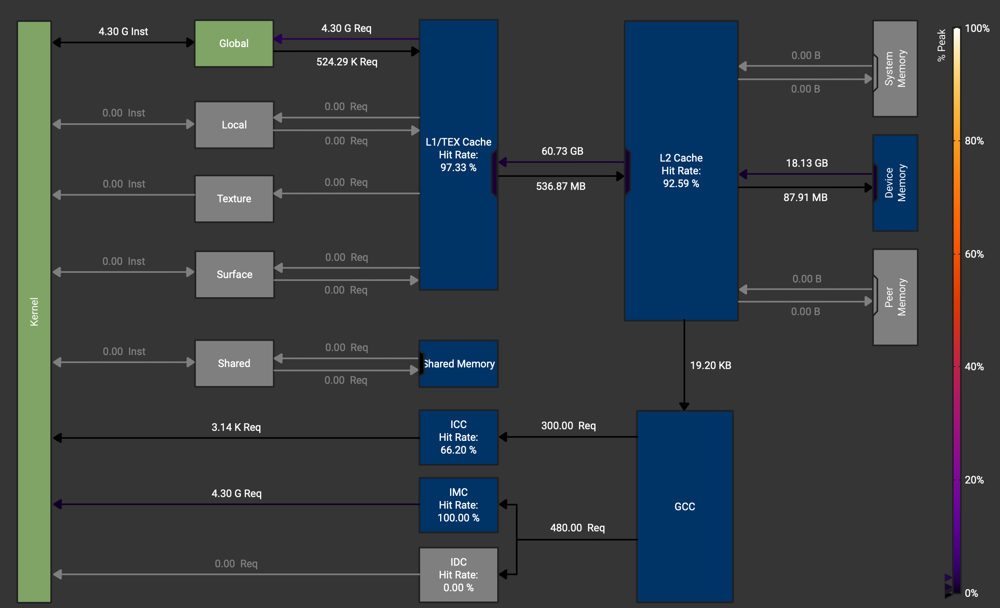

The theoretical minimum for the memory traffic we can get is the size of the
matrices themselves: `A_read + B_read + C_read + C_write = 4096^2 * 4 * 4 /
1024^2 = 256 MiB (size * bytes in f32 * four matrices / bytes in MiB)`.

In the worst case though, the amount of data the kernel could load
is `4096^2 * 2 * 4096 (multiplied row and column) * 4 / 1024 ^ 3 = 512 GiB` (+ the C
matrix read and write, which is negligible in comparison).

Most of this memory traffic however is amortized by the caches: we end up loading
"only" 18.13 GB. Notably, DRAM throughput stays very low at 0.96%, so loading these
18GB from the global memory is not what makes the kernel slow.

L1/TEX cache throughput shows `99.9%`. At the same time we see `16.5` sectors per
request reported for L1/TEX Cache usage. What happens here is most of the
accessed data is getting cached in L1. When we fetch the data from the cache,
the access is structured in 32 bytes blocks (or 8 fp32 numbers), called
sectors. Instructions to load the data from the memory are organized per-warp,
so for 32 lanes in warp we are requesting 32 floating point numbers from L1. If these
numbers are contiguous in memory, we would touch 4 sectors to access 32 numbers.
If they are not, however, we would touch up to 32 sectors in the worst case.

Let's break down the 16.5 sectors/request average we see:

```cpp
const uint x = blockIdx.x * blockDim.x + threadIdx.x;
const uint y = blockIdx.y * blockDim.y + threadIdx.y;
...
for (int i = 0; i < K; i++) {
  acc += A[x * K + i] * B[i * N + y];
}
```

For `A[x * K + i]`, lanes in a warp, following the `x` index access the elements of
the row-major matrix A in a column-major fashion, so each of the 32 accesses touches
a unique sector, 32 sectors in total. Then, for `B[i * N + y]`, `y` is slow-varying,
so the index is the same for each lane in the warp -- each lane loads the same
element, resulting in a broadcast access pattern: 1 sector/request. On average we
get `(32 + 1)/2 = 16.5` sectors/request.

We can arrive at the same number by looking at the raw L1 traffic:
`60.73 GB/ 32 B/sector = 1.8978125 GSectors` missed. Hit rate for L1 is 97.33%, so
`1.8978125/(1-0.9733) = 71.079 GSectors` in total. Divide that by 4.3 G inst (the
amount of requests L1 cache sees) and we get 16.53, closely matching the reported
number of sectors per request.

Another reflection of the same issue hides in the scheduling stats with issued
warp per scheduler showing only `0.03 = 1/32` instructions per cycle issued.
Warps are effectively stalling because of the congested L1 pathway: they are
competing for the same downstream resource. We also see that achieved occupancy
is reported at `97.91%`, pointing at the same thing: parallelism is not the
issue: we have an excess of active warps, but we can't schedule them.

Another two metrics pointing at the same thing: `Warp cycles per executed
instruction=250.39` with `Stall LG throttle=236.32`, meaning that on average
out of 250 cycles between two consecutive instructions to be issued, 236 cycles
a warp waits for the L1 queue.

Finally, we see that Compute Throughput is at mere `6.05%`. It's an aggregate metric,
showing maximum utilization across a number of pipelines.
In our case it coincides with `Mem Pipes Busy` from the `Memory Workload Analysis`.
This can also be seen on the Pipe Utilization graph:

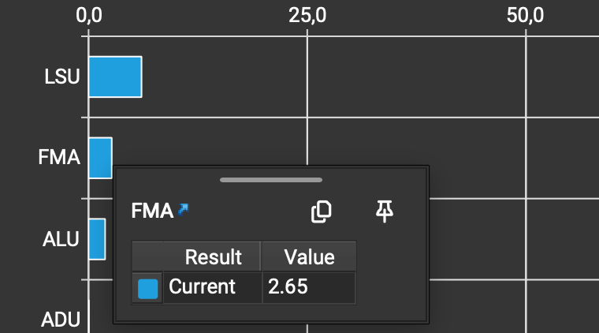

LSU stands for Load Store Unit and its value is exactly `6.05%`. FMA = fused
multiply-add pipeline shows mere `2.65%` - the pipeline that actually runs the arithmetic
is barely active. All in all, the pipelines are doing nothing, while L1 cache
throughput is at 99.9%.

#### Kernel 23: memory coalescing

After fixing the coalescing issue on the naive kernel, we see more than a 10x improvement
in the kernel duration: from 6s to 451 ms. The metrics that we observed earlier also
look better now:

- SM Throughput: `6.05% -> 79.2%` (Bounded now by memory throughput, same `79.2%`)
- DRAM Throughput: `0.96% -> 12.27%`
- L1/TEX Cache Throughput: `99.9 % -> 79.35%`
- Global Load Sectors/req: `16.5 -> 2.5`
- Issued warp per scheduler: `0.03 -> 0.41`
- Warp Cycles Per Issued Instruction: `250.39 -> 19.52 cycles`
- Stall LG Throttle: `236 -> 10.4 cycles`
- L1 <- L2 memory traffic: `60 -> 17 GB`
- Compute Workload Analysis: FMA: `2.65 -> 37.14`

Metrics normalized by a lot! At the same time, we're still bounded by the L1:
warps are waiting for 10 cycles on average in the L1 instructions queue (Stall
LG Throttle metric).

#### Kernel 25: shared memory blocking

For the next kernel the performance boost is significant: kernel duration drops
from 451 ms to 323 ms. We also note from the Warp State Statistics that the
limiting factor is not `Stall LG Throttle` anymore. Instead it's `Stall MIO
Throttle` at 26.72 cycles (MIO is the pipeline concerning the shared memory among other things).
Warp Cycles Per Issued Instruction also worsened to 41.36 cycles. But despite
those metrics being worse, we see that the total number of instructions went
down from 17.7G to 6G suggesting that we're doing less work now - almost 3-fold.

The original Boehm's write-up suggests that the performance increase for this kernel
should be attributed to the better data locality moving the matrices from global
to the shared memory. We saw however that for kernel 23 most of the traffic from DRAM
was already handled by the L1-cache, which runs on the same hardware as SMEM. Together
with worse Warp State metrics that hints that there might be more going on than mere
data locality.

I was pretty puzzled by the stats for this kernel and spent quite some time here.
One thing that catches the eye is the difference in the `Instruction
Statistics`: k23 has a lot of Integer SASS instructions compared to k25.

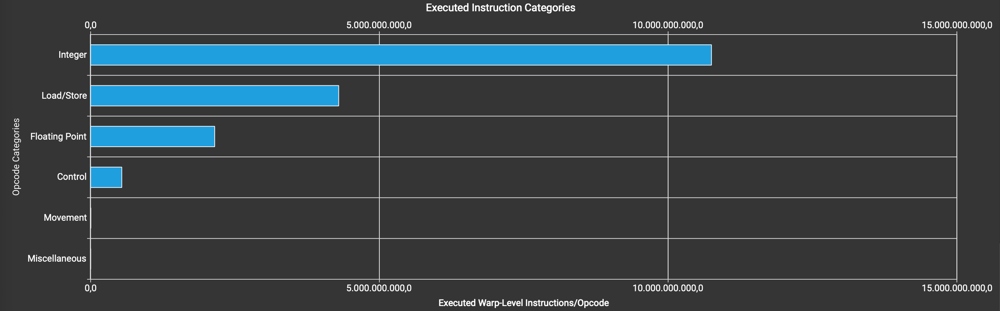

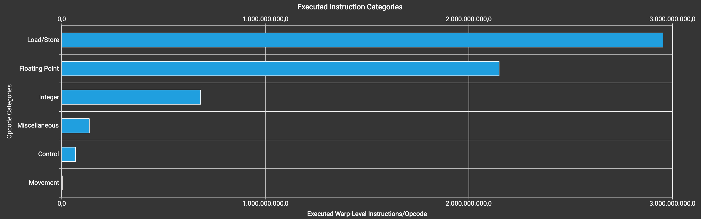

It's more than 10x difference in the absolute counts, making the integer
instructions the most frequent ones for k23. Apparently, this has to do with
how the addressing for the global memory works. First, the memory addresses for
DRAM are 64 bit instead of 32 bit for SMEM, so they require 2 instructions for
the pointer arithmetic instead of one. Second, for k25 we don't need the
pointer arithmetic as much: for SMEM accesses we don't need it at all because
the base is computed once per thread and for the inner loop we do the full
unrolling. For the global memory addressing, when loading the blocks into the
shared memory the number of integer operations is amortized since we load the
elements concurrently in a block and then reuse them in k25, as opposed to
loading from DRAM on every cycle of the inner loop for k23, where we need the
integer arithmetic to happen every time.

Integer arithmetic, however, is unlikely to be the bottleneck for k23. It
relies on the ALU and FMA pipes, and we're being limited by the LG Throttle,
while FMA and ALU pipelines are at 37% and 22.3% utilization for k23
respectively. Additionally, Issued warp per scheduler for k23 is at 0.41, so
the scheduler has empty slots to fit the integer instructions in if needed.

Note, that both MIO and LG under the hood rely on the same hardware, since L1
and shared memory are carved of the same SRAM. So why do we see any performance
gains at all, if we effectively have the same memory access pattern? The answer
to that hides behind the `Memory Workload Analysis` stats:

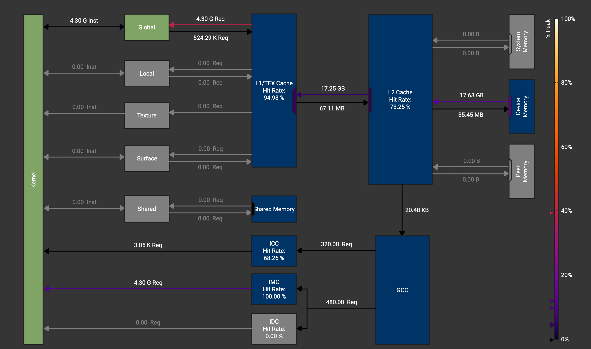

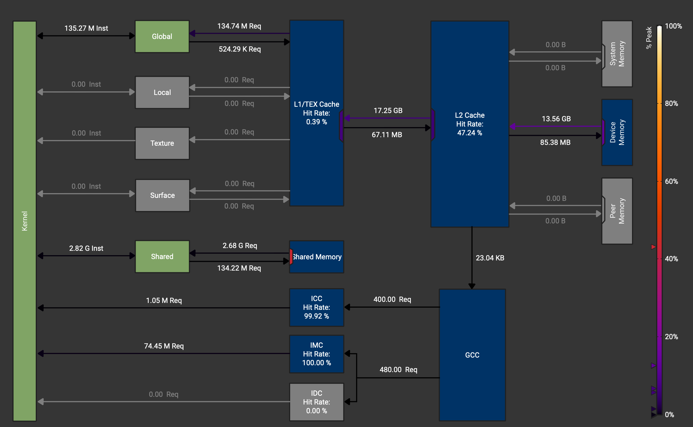

We see that for k25 the number of requests to the shared memory is much smaller
than the analogous number of k23's requests to L1: it's 2.68 G vs 4.30 G. That's interesting!
Let's try to calculate naively, how many SMEM requests our kernel need for a `4096x4096`
matrix multiplication. First, the inner loop is 4096 iterations, and inside we need
to load elements of A and B, from L1 in case of k23 and from SMEM in case of k25.
Then there are 4096^2 such loops, one per the output element, so `4096^3 * 2`, and that
total must be divided by 32, since the requests are formed per warp. That gives
`4096^3 * 2 / 32 = 4 294 967 296` - our 4.3 G for k23 up to a small delta.
The same should be true for k25, but its number of requests is almost 2 times lower!
The answer lies in the SASS source code for k25:

```asm
LDS.U R30, [R0.X4+0x1000]
LDS.U.128 R8, [R29]
LDS.U R33, [R0.X4+0x1080]
LDS.U R34, [R0.X4+0x1100]
LDS.U R35, [R0.X4+0x1180]
LDS.U R37, [R0.X4+0x1200]
LDS.U.128 R16, [R29+0x10]
LDS.U R38, [R0.X4+0x1280]
LDS.U R39, [R0.X4+0x1300]
LDS.U R40, [R0.X4+0x1380]
FFMA R8, R30, R8, R31
LDS.U R41, [R0.X4+0x1400]
LDS.U.128 R12, [R29+0x20]
FFMA R9, R33, R9, R8
FFMA R10, R34, R10, R9
LDS.U R32, [R0.X4+0x1480]
FFMA R11, R35, R11, R10
LDS.U R42, [R0.X4+0x1500]
LDS.U R30, [R0.X4+0x1580]
FFMA R16, R37, R16, R11
LDS.U R31, [R0.X4+0x1600]
LDS.U.128 R4, [R29+0x30]
FFMA R17, R38, R17, R16
FFMA R18, R39, R18, R17
LDS.U R36, [R0.X4+0x1680]
FFMA R19, R40, R19, R18
LDS.U R37, [R0.X4+0x1700]
LDS.U R34, [R0.X4+0x1780]
FFMA R12, R41, R12, R19
LDS.U R33, [R0.X4+0x1800]
LDS.U.128 R8, [R29+0x40]
FFMA R13, R32, R13, R12
FFMA R13, R42, R14, R13
LDS.U R38, [R0.X4+0x1880]
FFMA R13, R30, R15, R13
LDS.U R39, [R0.X4+0x1900]
LDS.U R32, [R0.X4+0x1980]
FFMA R4, R31, R4, R13
LDS.U R35, [R0.X4+0x1a00]
LDS.U.128 R16, [R29+0x50]
FFMA R5, R36, R5, R4
FFMA R5, R37, R6, R5
LDS.U R30, [R0.X4+0x1a80]
FFMA R5, R34, R7, R5
LDS.U R31, [R0.X4+0x1b00]
LDS.U R36, [R0.X4+0x1b80]
FFMA R5, R33, R8, R5
LDS.U R37, [R0.X4+0x1c00]
LDS.U.128 R12, [R29+0x60]
FFMA R5, R38, R9, R5
FFMA R10, R39, R10, R5
LDS.U R34, [R0.X4+0x1c80]
FFMA R10, R32, R11, R10
LDS.U R8, [R0.X4+0x1d00]
LDS.U R9, [R0.X4+0x1d80]
FFMA R10, R35, R16, R10
LDS.U R33, [R0.X4+0x1e00]
LDS.U.128 R4, [R29+0x70]
FFMA R17, R30, R17, R10
FFMA R18, R31, R18, R17
LDS.U R11, [R0.X4+0x1e80]
FFMA R19, R36, R19, R18
LDS.U R16, [R0.X4+0x1f00]
LDS.U R10, [R0.X4+0x1f80]
FFMA R12, R37, R12, R19
FFMA R13, R34, R13, R12
FFMA R8, R8, R14, R13
FFMA R9, R9, R15, R8
FFMA R4, R33, R4, R9
FFMA R5, R11, R5, R4
FFMA R6, R16, R6, R5
FFMA R31, R10, R7, R6
```

This is a fully unrolled inner loop. The interesting part there is that it uses
`LDS.U.128` instructions. If we look at the analogous part of k23, we'll see

```asm
IADD3 R4, R24, -0x3, RZ
IMAD.MOV.U32 R19, RZ, RZ, 0x4
IADD3 R8, R24, -0x2, RZ
IADD3 R12, R24, -0x1, RZ
IMAD.WIDE.U32 R4, R4, R19, c[0x0][0x170]
IMAD.WIDE.U32 R6, R28, R19, c[0x0][0x178]
LDG.E.SYS R4, [R4]
IMAD.WIDE.U32 R8, R8, R19, c[0x0][0x170]
LDG.E.SYS R7, [R6]
IMAD.WIDE.U32 R10, R25, R19, c[0x0][0x178]
IMAD.WIDE.U32 R12, R12, R19, c[0x0][0x170]
LDG.E.SYS R8, [R8]
IMAD.WIDE.U32 R14, R26, R19, c[0x0][0x178]
LDG.E.SYS R11, [R10]
IMAD.WIDE.U32 R16, R24, R19, c[0x0][0x170]
LDG.E.SYS R12, [R12]
IMAD.WIDE.U32 R18, R27, R19, c[0x0][0x178]
LDG.E.SYS R15, [R14]
LDG.E.SYS R16, [R16]
LDG.E.SYS R19, [R18]
```

It uses bare `LDG` -- the global memory instruction, which we know to be
hitting `L1`. So no vectorized access. Is it possible that using shared
memory blocks merely enabled a better use of the vectorized memory access --
and has nothing to do with data locality? To check this, I've coded 2
versions of the same kernel that attempt to disrupt the compiler optimizations
by using the runtime version of `BLOCKSIZE` instead of the compile-time one,
kernels 30 and 31:

```cpp
// Kernel 30: full runtime geometry. `bs` replaces BLOCKSIZE everywhere
__global__ void sgemm_shared_mem_block_runtime_dmalt(int M, int N, int K,
    float alpha, const float *A, const float *B, float beta, float *C, int bs) {

  __shared__ float As[32 * 32];
  __shared__ float Bs[32 * 32];

  const uint bkRow = blockIdx.x;
  const uint bkCol = blockIdx.y;

  const uint tCol = threadIdx.x % bs;  // runtime modulo
  const uint tRow = threadIdx.x / bs;  // runtime division

  A += bkRow * bs * K;
  B += bkCol * bs;
  C += bs * (bkRow * N + bkCol);

  float acc = 0.0;
  for (int bkIdx = 0; bkIdx < K; bkIdx += bs) {
    As[tRow * bs + tCol] = A[tRow * K + tCol];
    Bs[tRow * bs + tCol] = B[tRow * N + tCol];
    __syncthreads();

    A += bs;
    B += bs * N;

    for (int i = 0; i < bs; i++) {
      acc += As[tRow * bs + i] * Bs[i * bs + tCol];
    }
    __syncthreads();

  }
  C[tRow * N + tCol] = alpha * acc + C[tRow * N + tCol] * beta;
}

// Kernel 31: identical to 25 except the inner loop trip count comes from `bs`.
// All index arithmetic stays compile-time.
template <const uint BLOCKSIZE>
__global__ void sgemm_shared_mem_block_nounroll_dmalt(int M, int N, int K,
    float alpha, const float *A, const float *B, float beta, float *C, int bs) {

  __shared__ float As[BLOCKSIZE * BLOCKSIZE];
  __shared__ float Bs[BLOCKSIZE * BLOCKSIZE];

  const uint bkRow = blockIdx.x;
  const uint bkCol = blockIdx.y;

  const uint tCol = threadIdx.x % BLOCKSIZE;
  const uint tRow = threadIdx.x / BLOCKSIZE;

  A += bkRow * BLOCKSIZE * K;
  B += bkCol * BLOCKSIZE;
  C += BLOCKSIZE * (bkRow * N + bkCol);

  float acc = 0.0;
  for (int bkIdx = 0; bkIdx < K; bkIdx += BLOCKSIZE) {
    As[tRow * BLOCKSIZE + tCol] = A[tRow * K + tCol];
    Bs[tRow * BLOCKSIZE + tCol] = B[tRow * N + tCol];
    __syncthreads();

    A += BLOCKSIZE;
    B += BLOCKSIZE * N;

    for (int i = 0; i < bs; i++) {  // runtime trip count, everything else static
      acc += As[tRow * BLOCKSIZE + i] * Bs[i * BLOCKSIZE + tCol];
    }
    __syncthreads();

  }
  C[tRow * N + tCol] = alpha * acc + C[tRow * N + tCol] * beta;
}
```

The difference with k25 is that for k30 the `BLOCKSIZE` parameter is completely
replaced by a runtime parameter `bs`, and for k31 `bs` replaces only the inner
loop limit -- at this point Claude suggested that k25's performance gain might
be related to the full unrolling of the inner loop, which would be hindered by
the loop bound unknown at compile time. The latter proved to be the dead end, but
k31 appeared to be interesting for a different reason.

And the performance for the 2 kernels is: \[...drum roll\]

- k30: 447ms
- k31: 345ms.

So replacing the `BLOCKSIZE` with a runtime variable puts the SMEM blocking
kernel back to the k23's performance, while having the same tiling
structure and therefore the same data locality as k25!

Let's take a look at the number of `SMEM` requests for these two kernels:

- k30: 4.29 G
- k31: 3.22 G

So k30 is back to 2 requests/iteration -- no vectorization (confirmed by its SASS).
But k31 is weird: some vectorization is there, but it's not the same as k25. SASS sheds
light on it:

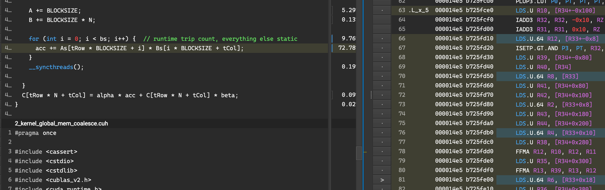

So it uses `LDS.U.64` instructions! Why not `LDS.U.128`? I don't know. But that explains
the difference in the requests total.

Another puzzling thing is that despite the number of requests to SMEM being
significantly higher for k31 vs k25 (3.22 G vs 2.68 G) performance stays on
par: 345 ms vs 323 ms. That was quite puzzling to me at first. I'm just gonna
give away the answer here: it's because both vectorization instructions result
in the same amount of the shared memory wavefronts:

| kernel | Requests   | Wavefronts |
| ------ | ---------- | ---------- |
| k23    | 4295491584 | 4295491584 |
| k25    | 2684354560 | 3221225472 |
| k30    | 4294967296 | 4294967296 |
| k31    | 3221225472 | 3221225472 |

So we see that k25 is the only kernel for which the number of requests doesn't
match the number of wavefronts. Likely, what happens here is that `LDS.U.128`
is translated into 2 wavefronts, while `LDS.U.64` - into 1. Using the same
arithmetic, but with 1.25 and 1.5 LDS/iteration instead of 2 we get exactly
2.68 G and 3.22 G requests. Note, that, the wavefronts number matches the
kernels' performance: k25 is on par with k31, while k23 is similar to k30.

One thing to mention regarding the table above is that number in the table
above come from two different subsections in the `Memory Workload Analysis`
section: for k25, k30 and k31 I report `Shared Memory -> Shared Load` requests
and wavefronts, while for k23 the numbers come from `L1/TEX Cache -> Global
Load`, which should make provided what we already discussed.

##### Vectorized loads and alignment

One note on why introducing the runtime variable `bs` makes the compiler opt
for the non-vectorized version. I assume that in order for compiler to know it
can load array in a vectorized fashion, it needs two things:

1. The elements of the array must be read contiguously
2. the compiler must see at compile time that the wide load starts
   on a suitable boundary: a multiple of 2 floats for `LDS.64` and of 4 floats
   for `LDS.128`

Now, let's take a closer look at the line, where the load instructions occur:

```cpp
acc += As[tRow * bs + i] * Bs[i * bs + tCol];
```

One thing we see is that `As` is indexed with its fastest index `i`
contiguously, while for `Bs` we access the elements with the stride `bs` so
condition 1 breaks here. This is why when vectorization does occur, it affects
only `As`. Now to the second one: when `bs` is a runtime variable, compiler has
no way to reason about elements' alignment, so it just uses the basic one-float
`LDS`. At least in theory.

If the theory is correct, we should see the drop in performance not only when
the stride is a runtime variable, but also when it's a compile-time constant, but
not a multiple of 2 (for `LDS.64`) or 4 (for `LDS.128`). To test this I constructed another version of k25, where the stride for `As` is controlled separately:

```cpp
  ...
  __shared__ float As[BLOCKSIZE * STRIDE];
  ...
  for (int bkIdx = 0; bkIdx < K; bkIdx += BLOCKSIZE) {
    As[tRow * STRIDE + tCol] = A[tRow * K + tCol];
    Bs[tRow * BLOCKSIZE + tCol] = B[tRow * N + tCol];
    __syncthreads();

    A += BLOCKSIZE;
    B += BLOCKSIZE * N;

    for (int i = 0; i < BLOCKSIZE; i++) {
      acc += As[tRow * STRIDE + i] * Bs[i * BLOCKSIZE + tCol];
    }
    __syncthreads();
  }
  ...
```

I've set the stride values to 33, 34 and 36 to check what would happen when
the stride is odd, a multiple of 2 and a multiple of 4. The expectation is
of course that we'd see `LDS`, `LDS.64` and `LDS.128` respectively in SASS.

The durations of the three versions of this new kernel are below:

|              |     |     |     |
| ------------ | --- | --- | --- |
| STRIDE       | 33  | 34  | 36  |
| duration, ms | 430 | 338 | 329 |

And the assembly code indeed matches the prediction: we see only `LDS` for `STRIDE=33`, `LDS.64` for `STRIDE=34` and `LDS.128` for `STRIDE=36`.

As expected, the times fall into the same performance bins as their counterparts:

|              |             |                |                 |
| ------------ | ----------- | -------------- | --------------- |
| kernel       | k30 (`LDS`) | k31 (`LDS.64`) | k25 (`LDS.128`) |
| duration, ms | 447         | 345            | 323             |

So we see that performance gains for k25 are most likely coming from a compiler
memory optimization that occurred almost by chance and not for the reason the
changes were introduced. In this particular case the mechanism is making the compiler see the elements are properly aligned for the vectorized loads.

##### K25's conclusion

What did I learn from this lengthy side-quest? I guess I can boil it down to
the following:

- Sometimes things can get randomly better
- Looking at SASS alongside with the metrics can provide valuable insights into
  the kernel's performance. And sometimes it's the only way.
- Sometimes a better kernel means worse metrics, as we saw for the Warp State
  Statistics for k25
- Reasoning about the kernel performance just from the first principles is
  hard and can be misleading, so verifying the assumptions with numbers is a must

#### Kernel 26: 1D blocktiling

Kernel duration improved to `145ms`. We also see much fewer requests to SMEM
(805 306 368 for the Shared Load with 1 342 177 280 wavefronts).

Instruction statistics for the first time show floating point operations as
the most prominent type:

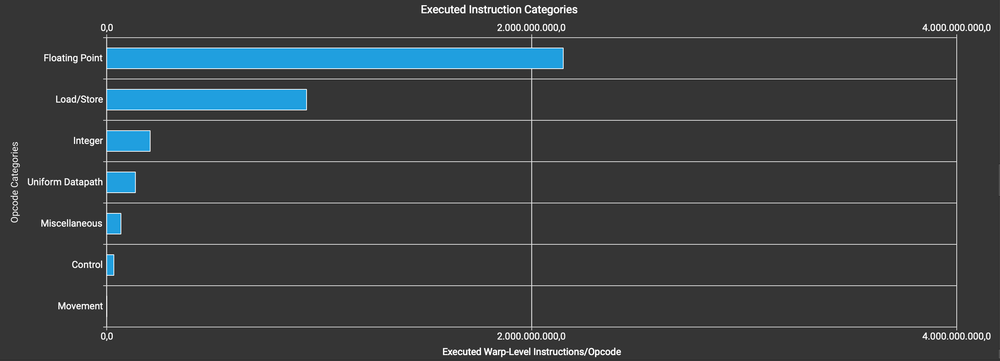

MIO throttle is still the leading cause of stall, but the metrics are much
better: 6.02 cycles out of 15.68 cycles in total Warp Cycles Per Issued
Instruction. It hints towards the next optimization: easing the shared memory load
even further with 2D blocktiling.

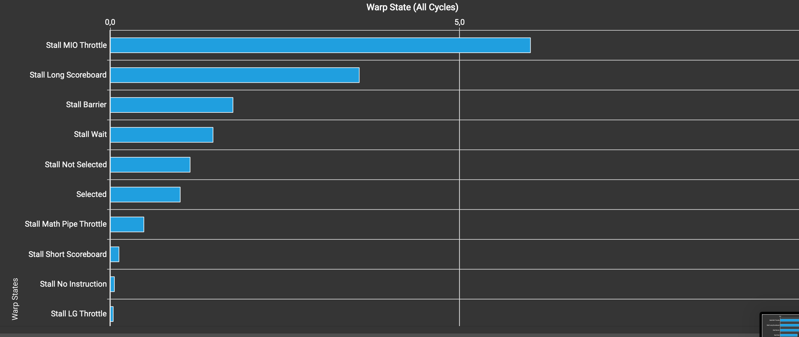

One note regarding Boehm's post: it's As that's loaded with `LDS.128`, not Bs.
It also suggests that it's fine to read As non-contiguously in the inner loop:
compiler recognizes that we read the whole BK \* TM chunk in two nested loops and
optimizes the loads for us.

Another notable thing is that occupancy dropped to 50% because of the registers
limit. I tried increasing it back to 100% by compiling with `-maxrregcount=64`,
which indeed raised the occupancy, but the duration stayed roughly the same:
147ms. Possibly what happens is we're still being limited by the shared memory,
so adding more warps simply means longer queues.

#### Kernel 27: 2D blocktiling

Nice 2x improvement on duration: 74.4ms.
We also see much better arithmetic pipes utilization (blue: k27, green: k26):

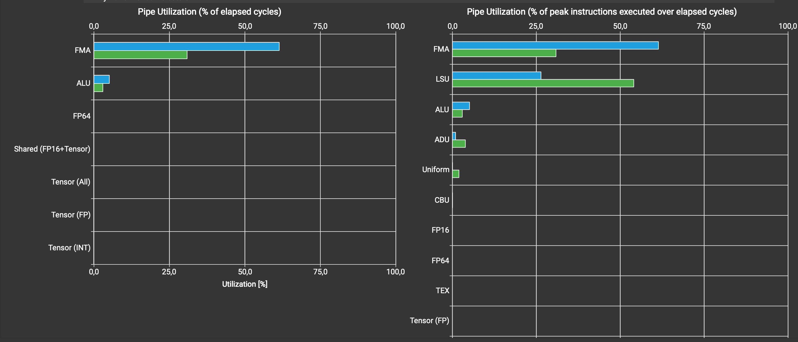

The warp stalls are significantly reduced, but MIO Throttle remains the main
warp stalling factor:

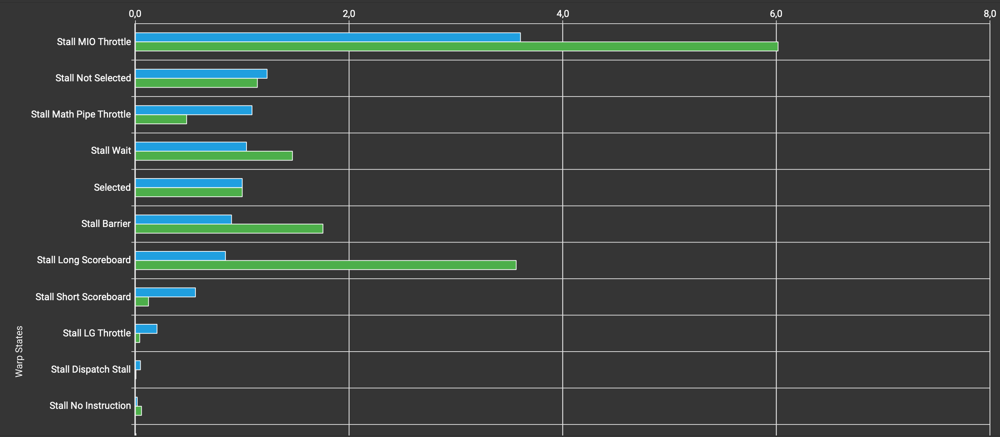

Interestingly, we now see bank conflicts on the shared load, which were not there before. We have 301 989 888 in total.

We also see the increased utilization of L1 cache again: the hit rate for k27 sits at 18.8% vs 0.77% for k26.

Shared memory requests are down to 167772160 (-79.17% vs k26) and the
wavefronts - to 738197504 (-45.00% vs k26).

Looking at SASS for the shared memory load instructions I see the mixture of
`LDS` and `LDS.128` for this code below loading `As`:

```cpp
for (int iDot = 0; iDot < BK; ++iDot) {
  for (int iTM = 0; iTM < TM; ++iTM) {
    regTM[iTM] = As[(iTM + tRow * TM) * BK + iDot];
  }
  ...
}
```

Something funky is going on there, but it seems like the
data are already loaded with `LDS.128`. Likely, the compiler again is able
to reason about both `iDot` and `iTM` loops at the same time and figure out
the optimized memory access pattern.

As expected, `Bs` loading loop (below) uses `LDS.128` everywhere. 'As expected' because the fast variable iterates over the contiguous bytes.

```cpp
for (int iTN = 0; iTN < TN; ++iTN) {
  regTN[iTN] = Bs[iDot * BN + iTN + tCol * TN];
}
```

#### Kernel 28: SMEM and GMEM vectorization

- Kernel 28 is marginally faster: 69.3ms (-6.91%).
- All of the load instructions for As are now vectorized to `LDS.128`.
- The global loads turned from `LDG` to `LDG.128`, so that change took effect.
- Number of requests to shared memory is down by 20%, of wavefronts - by 9%.
- Bank conflicts for shared load are down by 11%, but the new 16777216 shared store conflicts were introduced.
- Stall MIO throttle is down by 6% to 3.39.

Looks like the main effect of this change is removing the rest of unvectorized
load instructions for As loading. At least, the 6% reduction in MIO throttle
correlates pretty well with the performance improvement.

MIO stays the main stalling reason with the bank conflicts being the next most
obvious thing for improvement.

#### Kernel 29: bank conflicts

- The duration is down by 12% to 60.62 ms
- MIO throttle is down to 1.3 cycles and is no longer the main stalling reason.
  It subsided to "Stall Not Selected" with 1.88 cycles out of 8 warp cycles per issued instruction
- Shared load bank conflicts are gone
- Shard store bank conflicts are up by 100% to 33554432
- The number of Shared Memory Load requests is up by 150% to 335544320, but
  the wavefronts number is actually down by 40%: 402653184. This attributes to
  `Bs`'s shared load going back to using unvectorized `LDS` loads.
- The ultimate limit we should hit for an optimal kernel is the FMA pipeline.
  For k29 it's at 74.42% utilization, suggesting another 25% duration cut should
  be theoretically possible.


> [!NOTE]
> "Stall Not Selected" means that the warp was ready, but another warp was selected instead. It's not really a stall. [Nvidia docs on this](https://docs.nvidia.com/nsight-compute/ProfilingGuide/index.html#warp-stall-reasons)

## Notes

`sgemm_coalesce_indswap_dmalt` vs `sgemm_coalesce_dmalt` shenanigan:

- Both kernels are byte-for-byte identical at L1 and L2 request level
- They differ only in DRAM bytes per L2 miss (48.8 vs 122.5)
- Neither difference reaches performance: both are load-issue bound at ~79%, and across
  six paired runs the throughput gap is 2.5%, inside run-to-run variance

`sgemm_shared_mem_block_dmalt`

Tiling was supposed to reduce the number of the DRAM accesses from 4096**3 *2
to 32* 4096 *2* (4096 / 32)** 2 = 4096 \*_3 \_2 / 32, so x32. However, we
don't see it from the metrics. Mem TP 2 (Memory Throughput from the Memory
Workload Analysis table) shows 41.24 GB/s_ 331 ms = 13.65 GB of DRAM vs 38.51
GB/s\_ 460 ms = 17.71 GB for the coalescing kernel, so the DRAM traffic is
indeed reduced, but not 32-fold -- only by 23%. The suspected reason that L1
cache absorbs the hit in the coalescing kernel.

```

```
