# The what and why

Recently I embarked on a journey of learning the ins and outs of the ML models
machinery. One corner of it that specifically drew my attention is CUDA
programming -- tooling that powers those fast matrix multiplications that make
modern AI possible in the first place. And since I think the best way to
learn a thing is to build it yourself, I decided to lockstep [Boehm's excellent
worklog](https://siboehm.com/articles/22/CUDA-MMM) on coding a matrix
multiplication kernel performing at about 94% of cuBLAS.

This post is my account of re-implementing a large chunk of the ladder, but more in
the
[analysis-driven](https://developer.nvidia.com/blog/analysis-driven-optimization-preparing-for-analysis-with-nvidia-nsight-compute-part-1/)
fashion: I profile each intermediate kernel to see if the numbers pave the
same path as the original worklog suggests, while learning the tooling in the process.

In the end, I reach a similar 94% of cuBLAS performance, albeit with a different
kernel (makes sense, I use a T4 GPU vs Boehm's A6000). Most importantly though,
using the profiler revealed that the textbook story about the data locality and
optimizing the off-chip memory usage appears to be over-simplified and somewhat
misleading: the L1 cache absorbs most of the hit for the DRAM access, and the
real story behind some of the performance gains actually involves the on-chip
optimizations.

More generally, I once again confirmed for myself that closing the feedback
loop with the proper tooling when doing the performance optimizations is very
important and sometimes the story we tell ourselves about how something works
can lead us astray.

## The setup: Colab + local profiling info analysis

To climb the ladder I used the following setup:

- Clone Boehm's repo, code my kernels alongside his, use his harness to
  evaluate
- Use Google Colab for the GPU access:
  - It's free
  - It adds the profiling information (not all platforms do)
- The GPU I used on Colab is one of the default ones: Nvidia T4
- For the profiling info analysis I used a split setup:
  - run the NCU profiler on the Colab cloud machine
  - download the profiler's reports
  - analyze them locally using the NCU UI
- I used a single matrix size to profile to save time: 4096x4096
- The durations I report below are the ones from the NCU profiler, and NCU locks
  the clock at the base rate (600 MHz in my reports), so the durations should
  only be judged in comparison, not as absolute numbers.
- I analyzed the profiling metrics together with Claude Code constantly
  cross-checking my understanding of what's going on.

### On the profiler setup

Nvidia has an excellent profiler for analyzing the kernel's performance,
[NCU](https://developer.nvidia.com/tools-overview/nsight-compute/get-started).
It supports both a CLI and a graphical UI, and I leaned at first towards using the
CLI for three reasons:

- it's the most straightforward in the cloud-based setup (I run the kernel in Colab)
- it's easier to integrate with the AI tooling
- I find it easier in general to deal with the terminal tools than with UIs

However, NCU has a lot of metrics, some of which are quite complex, and I
quickly realized that using a GUI provides some crucial benefits, especially
for someone who's learning:

- it represents the data visually, so it's easier to digest, especially with
  things like the baseline comparison, which allows you to compare the kernels
  among each other
- with all the data gathered in one place and easy to navigate to, it makes
  discoverability much less of an issue, which is a huge deal for someone who's
  learning what tools and techniques are available for the first time.

Below is the code I used in the Colab notebook to run the profiler.

Cloning and building the repo:

```sh
%%bash

rm -rf sgemm
git clone https://github.com/dmalt/SGEMM_CUDA.git sgemm && cd sgemm
cmake -S . -B build -DCMAKE_BUILD_TYPE=Release -DCMAKE_CUDA_FLAGS="--generate-line-info"
cmake --build build --parallel
```

Notice the `--generate-line-info` flag -- we need it to tie the CUDA kernel
code lines to the generated assembly for the later analysis.

Then run the following to profile the kernels:

```sh
# Running the profiler
while read -r id name; do
  echo "-------- $id $name ------- "
  ncu --set full \
      -o "k${id}_full" --force-overwrite \
      --kernel-name "regex:${name}" \
      --launch-skip 10 --launch-count 1 \
      ./sgemm/build/sgemm "$id"
done <<'EOF'
21 sgemm_naive_dmalt
23 sgemm_coalesce_dmalt
25 sgemm_shared_mem_block_dmalt
26 sgemm1DBlocktilingDmalt
27 sgemm2DBlocktilingDmalt
28 sgemmVectorizeDmalt
29 sgemmResolveBankConflictsDmalt
EOF

zip reports.zip k*_full.ncu-rep
```

## The naive kernel: diagnosing memory coalescing issues with sectors/request

Running the naive kernel took 2.25 seconds on the T4 (Boehm's A6000 produced
0.5s for comparison) -- very slow, no surprises there. As explained by the
original post, assuming zero caching we load 548 GB from DRAM. In addition, the
access pattern for matrix `A` is not ideal: we load the elements that are
placed in memory non-contiguously.

Let's look at the metrics to see if that explanation holds. Below is the table
from the Speed Of Light section in NCU:

| Metric                      | Value | Metric                   |         Value |
| --------------------------- | ----: | ------------------------ | ------------: |
| Compute (SM) Throughput [%] |  6.05 | Duration [s]             |          5.91 |
| Memory Throughput [%]       | 49.95 | Elapsed Cycles [cycle]   |    3548921497 |
| L1/TEX Cache Throughput [%] | 99.90 | SM Active Cycles [cycle] | 3543970101.57 |
| L2 Cache Throughput [%]     |  1.22 | SM Frequency [Mhz]       |        600.00 |
| DRAM Throughput [%]         |  0.96 | DRAM Frequency [Ghz]     |          5.00 |

Note that the NCU-reported duration is much higher than 2.25 seconds coming
from Boehm's profiling harness. That's the effect of profiling mentioned above.

One thing that immediately catches the eye is that the kernel sits at 99.9%
L1/TEX cache throughput. Let's take a look at the Memory Chart from the 'Memory
Workload Analysis' section:

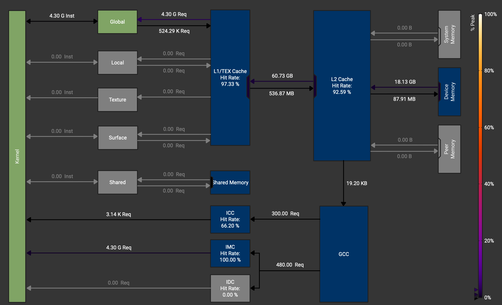

We see that the total hit rate for L1 is at 97.33%, so most of the GMEM
accesses actually do get cached! Overall we load 18.13GB of traffic from GMEM
to the on-chip memory, which is very significant, but nowhere near the
potential 548 GB maximum.

Another thing to notice is that the DRAM throughput is a mere 0.96%. The global
memory pipeline is barely doing anything! It tells us that those 18GB of global
memory traffic are not really the bottleneck.

The answer hides in one of the NCU optimization suggestions:

> On average, each warp of this workload spends 236.3 cycles being stalled
> waiting for the L1 instruction queue for local and global (LG) memory
> operations to be not full. Typically, this stall occurs only when executing
> local or global memory instructions extremely frequently. Avoid redundant
> global memory accesses. Try to avoid using thread-local memory by checking if
> dynamically indexed arrays are declared in local scope, or if the kernel has
> excessive register pressure causing spills. If applicable, consider combining
> multiple lower-width memory operations into fewer wider memory operations and
> try interleaving memory operations and math instructions. This stall type
> represents about 94.4% of the total average of 250.4 cycles between issuing
> two instructions.

Let's take a look at the Warp State Statistics for the naive kernel:

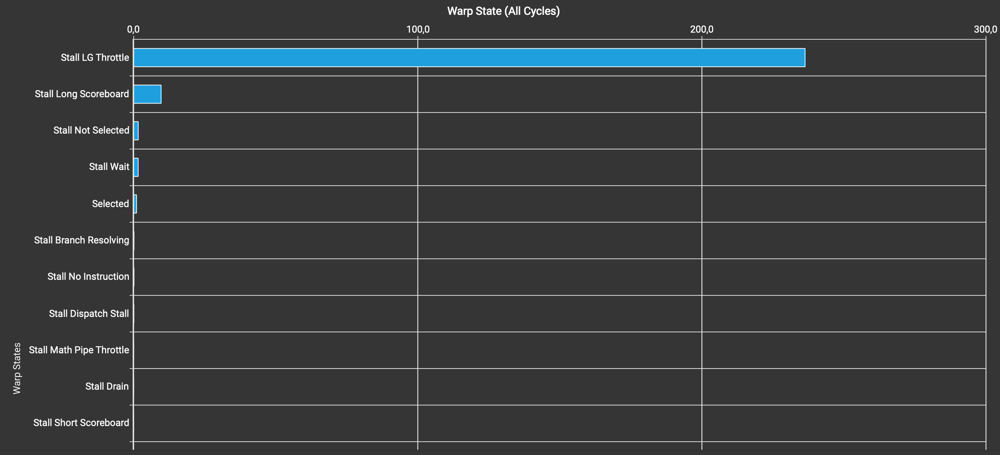

We see that same 236 out of 250 cycles figure for the 'Stall LG Throttle'.
What's 'LG Throttle'? To quote the Nvidia Developer blog on this, it's

> ... “average # of warps resident per issue cycle, waiting for a free entry in the
> LSU instruction queue”. LSU is Load/Store Unit, one of the functional units in
> a GPU SM.

So the warps are stalled waiting for the LSU pipeline. This pipeline is the one
that's responsible for the requests to L1. Let's check the Compute Workload
Analysis section, which reports utilization of the pipes, including LSU:

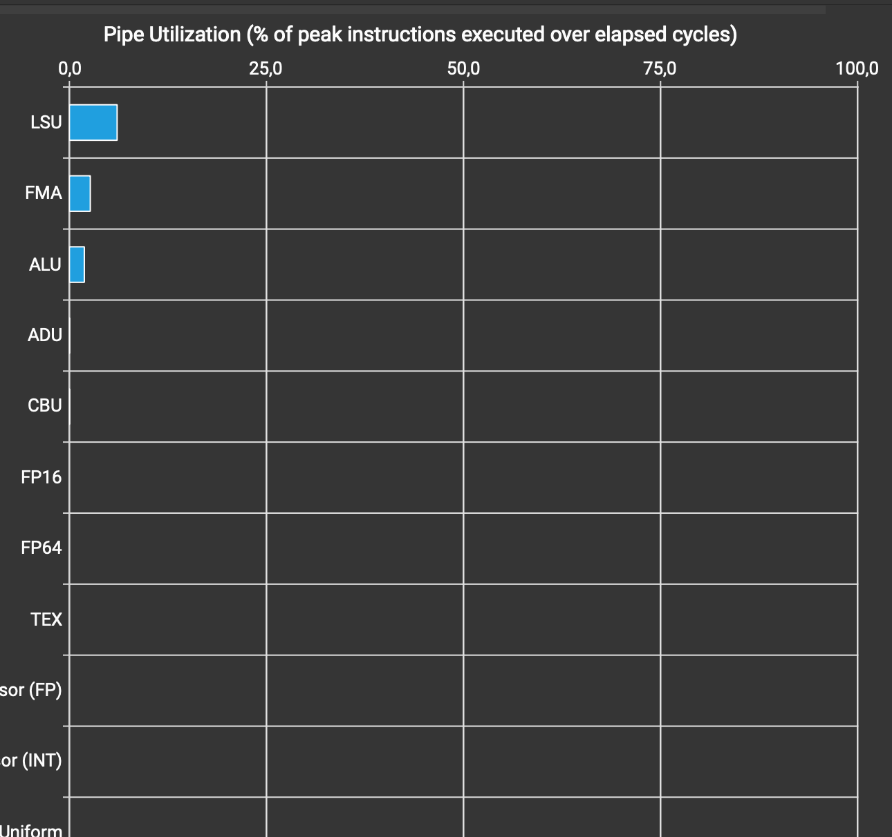

It sits at a mere 6.05%. Same number as we saw in the SOL table above for the
Compute Throughput. The reason is that Compute Throughput is an aggregate metric - it
reports the maximum among several other metrics, LSU being one of them.

But the important part is that LSU is nowhere near saturation. So it's not like
we make too many requests to the LSU. But it's the one we're waiting for. What
does it mean? Should be obvious, but it wasn't for me at the time. It means
that we don't use it efficiently. And there's another metric pointing at this.

If we look at the "Memory Workload Analysis" section and switch from 'Memory Chart'
to 'Memory Tables' in the dropdown next to the section title, we'll see a whole bunch
of stats in the L1/TEX Cache section. We're interested in the column called
'sectors/request'. For the 'Global Load' section it reads '16.5'. This is very high!

To see why, we need to understand what a sector is and what a good memory access
pattern should look like. When we fetch data from L1, the access is
structured in 32-byte blocks (or 8 fp32 numbers), called sectors. Instructions
to load the data from the memory are organized per-warp, so for 32 lanes in
a warp we are requesting 32 floating point numbers from L1. If these numbers are
contiguous in memory, we would touch 4 sectors to access 32 numbers. If they
are not, however, we would touch up to 32 sectors in the worst case. And whenever
we touch a sector on L1, the whole sector gets moved. So in our case of average
16.5 sectors per request we effectively touch 4.125 times more data than needed.
This is the manifestation of the uncoalesced memory access mentioned in
Boehm's longread.

Let's see where this number comes from. Here's how we multiply a row of A by a column
of B:

```cpp
const uint x = blockIdx.x * blockDim.x + threadIdx.x;
const uint y = blockIdx.y * blockDim.y + threadIdx.y;
...
for (int i = 0; i < K; i++) {
  acc += A[x * K + i] * B[i * N + y];
}
```

For `A[x * K + i]`, lanes in a warp, following the `x` index, access the elements of
the row-major matrix A in a column-major fashion, so each of the 32 accesses touches
a unique sector, 32 sectors in total. Then, for `B[i * N + y]`, `y` is slow-varying,
so the index is the same for each lane in the warp -- each lane loads the same
element, resulting in a broadcast access pattern: 1 sector/request. On average we
get `(32 + 1)/2 = 16.5` sectors/request.

So what happens is because of the uncoalesced memory access every request loading
elements of matrix A touches 8x the data it needs, causing every request to be slow,
hence the low LSU throughput clogging up everything downstream.

Coming back to the L1/TEX cache throughput of 99.9%. It's also the aggregate metric
and, to tie it back to the sectors/request, I looked into what it's composed of and
what is the primary limiting one. It can be done similar to this:

```sh
ncu --metrics breakdown:l1tex__throughput.avg.pct_of_peak_sustained_active \
    --kernel-name regex:sgemm_naive_dmalt --launch-count 1 \
    ./sgemm/build/sgemm 21
```

The output I got was as follows:

```txt
 Section: Command line profiler metrics
 -------------------------------------------------------------------------- ----------- ------------
 Metric Name                                                                Metric Unit Metric Value
 -------------------------------------------------------------------------- ----------- ------------
 ...
 tpc__l1tex_data_pipe_lsu_wavefronts.avg.pct_of_peak_sustained_active                 %        99.90
 ...
 -------------------------------------------------------------------------- ----------- ------------

```

So the actual metric that's at 99.9% is
`tpc__l1tex_data_pipe_lsu_wavefronts.avg.pct_of_peak_sustained_active` and it
measures the LSU pipeline utilization inside the L1 unit. As you see, it all agrees
with the LG Throttle we saw from the Warp State Statistics.

Note that the metric mentions 'wavefronts'. Let's use this as an excuse to define
wavefronts here since they'll play an important role later.

> Wavefront is a unique "work package" generated at the end of the processing
> stage for requests.

Importantly, when a warp generates a request, each request means at least one
wavefront, but the opposite is not necessarily true -- one request can also
translate into multiple wavefronts.

Back to our business. To conclude, the detailed metrics-grounded breakdown of
what happens is as follows.

- We try to load way too much from GMEM
- Most of the GMEM traffic gets cached in L1
- We load the cached elements of matrix A on L1 in an uncoalesced manner.
- This leads to a high number of sectors/request accessed.
- This in turn generates an elevated number of wavefronts
- The wavefronts flood the LSU unit inside L1, causing the 99.9% utilization
  and very long warp stalls.

Or at least I think that's what happens: some of the things, like how
sectors/request translate into the wavefronts, I can't directly ascertain.

## The coalesced kernel: identifying L1 as the bottleneck with the warp state statistics

To mitigate the observed issues with the naive kernel, we swap `threadIdx.x`
and `threadIdx.y` between what indexes rows and what columns of A;
the rest of the kernel stays the same as the naive version:

```cpp
const uint iCol = blockIdx.x * blockDim.x + threadIdx.x;
const uint iRow = blockIdx.y * blockDim.y + threadIdx.y;
if (iRow < M && iCol < N) {
  float acc = 0.0;
  for (int i = 0; i < K; i++) {
    acc += A[iRow * K + i] * B[i * N + iCol];
  }
  C[iRow * N + iCol] = alpha * acc + beta * C[iRow * N + iCol];
}
```

> [!NOTE]
> Boehm in his article does it differently: he uses
> a single linear thread index `threadIdx.x` and manually wraps it
> into a 2D structure with:
> `const uint iCol = blockIdx.y * BLOCKSIZE + (threadIdx.x % BLOCKSIZE);`
> `const uint iRow = blockIdx.x * BLOCKSIZE + (threadIdx.x / BLOCKSIZE);`
> Our approach is equivalent. I just felt bare swapping is a more atomic next step.

The point of swapping is that `threadIdx.x` is the 'fast' thread index,
so when a warp is formed, it's assembled of threads with the adjacent values
of `threadIdx.x`. So what swapping does for us is that threads in the same warp
now load the same element of matrix A and different, but contiguous in memory
elements of matrix B.

After the fix we see more than a 13x improvement in the kernel duration: from
6s to 451 ms (NCU times). The metrics that we observed earlier
also look much better now:

- SM Throughput: `6.05% -> 79.2%` (Bounded now by memory throughput, same `79.2%`)
- DRAM Throughput: `0.96% -> 12.27%`
- L1/TEX Cache Throughput: `99.9 % -> 79.35%`
- Global Load Sectors/req: `16.5 -> 2.5`
- Issued warp per scheduler: `0.03 -> 0.41`
- Warp Cycles Per Issued Instruction: `250.39 -> 19.52 cycles`
- Stall LG Throttle: `236 -> 10.4 cycles`
- L1 <- L2 memory traffic: `60 -> 17 GB`
- Compute Workload Analysis: FMA: `2.65 -> 37.14`
- LSU pipe utilization: `6.05% -> 79.2%`

They all point to the same thing: the coalescing fix worked. The Global Loads now
touch far fewer sectors per request on average, the LSU unit on L1 is not choking
anymore because of how heavy the requests are and we don't waste an absurd
number of cycles on waiting for it in the warp scheduler. Good.

However, L1's LSU is still the busiest part of the kernel, just not because of
how slow each request is but because of how many there are: the warp scheduler
still stalls with that same LG Throttle. Note also the LSU utilization rising
from 6.05% to 79.2%: it points to that same shift in the limiting factor for L1
from latency to the number of requests.

Note also that the hit rate for L1 is still very high at 94.98%, so most
of the inefficiency of loading from global memory is absorbed by the L1 cache.

## Shared memory blocking: shifting the bottleneck and how the intuition fails us

What Boehm does next in his post is lay out the global memory access textbook
argument. He argues that since all our loads are to the global memory and
global memory loads are awfully slow, we can make use of the fact that
most of the data for SGEMM is being reused and preload the reused matrix blocks
into SMEM.

We saw, however, that most of the data traffic is served from L1 cache, which is
physically already located in the same place as SMEM. So preloading the data
into the shared memory should bring about no performance improvement, right?

Well, it still does! The shared memory blocking kernel is about 40% faster: the
duration shrinks from 451.85ms to 323.16ms, so it's not insignificant. What the
hell? Let's check the metrics.

### Global memory access patterns are not the issue

First, from the Warp State Statistics we see that the limiting factor is not
`Stall LG Throttle` anymore. Instead it's `Stall MIO Throttle` at 26.72 cycles
(MIO is the pipeline concerning the shared memory among other things). Warp
Cycles Per Issued Instruction also worsened to 41.36 cycles. So for the warps stalls
we went from 10.4/19.52 (LG) to 26.72/41.36 (MIO) cycles -- much worse!

On the other hand, we see that the total number of instructions went down from
17.7G to 6G suggesting that we're doing less work now - almost 3-fold.

Looking at the Memory Workload charts for the coalesced kernel (k23) and the
shared memory one (k25) we also see far fewer requests to the shared memory:

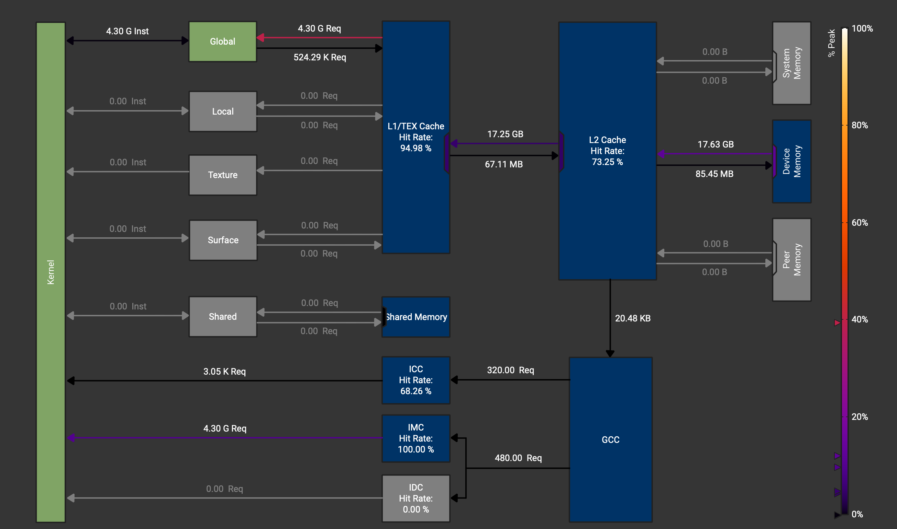

---

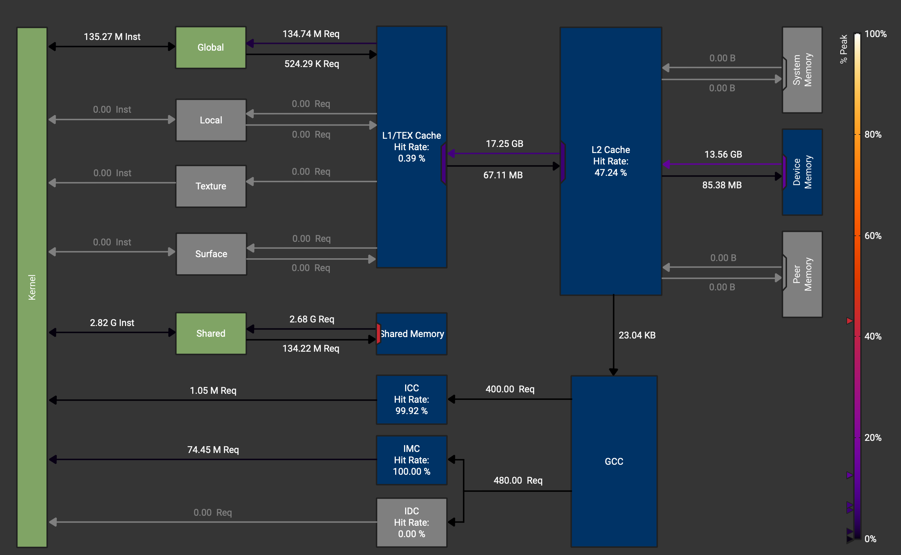

We already know that L1 and Shared memory are effectively the same thing, and
the number of requests went down from 4.3G to 2.68G. Provided that we already
know that the global memory traffic is not the issue, that must be it!

### Diagnosing the SMEM instructions shrink with SASS

Let's try to calculate naively how many SMEM requests our kernel needs for a
`4096x4096` matrix multiplication. First, the inner loop is 4096 iterations,
and inside we need to load elements of A and B, from L1 in case of k23 and from
SMEM in case of k25. Then there are `4096^2` such loops, one per output
element, so `4096^3 * 2`, and that total must be divided by 32, since the
requests are formed per warp. That gives `4096^3 * 2 / 32 = 4 294 967 296` -
our 4.3 G for k23 up to a small delta. The same should be true for k25, but its
number of requests is almost 2 times lower! Let's take this inner loop of the kernel

```cpp
...
for (int i = 0; i < BLOCKSIZE; i++) {
  acc += As[tRow * BLOCKSIZE + i] * Bs[i * BLOCKSIZE + tCol];
}
...
```

and see the SASS code that the compiler generated for it in k25. The
instructions below are grouped and annotated by Claude for readability; it's
not the compiler's order. Note also that the `BLOCKSIZE` we statically define in
the code is 32.

```asm
// iterations 0-3
LDS.U.128 R8, [R29]               // A[0..3] -> R8..R11
LDS.U R30, [R0.X4+0x1000]         // B[0]
FFMA R8, R30, R8, R31             // acc += A[0] * B[0]
LDS.U R33, [R0.X4+0x1080]         // B[1]
FFMA R9, R33, R9, R8              // acc += A[1] * B[1]
LDS.U R34, [R0.X4+0x1100]         // B[2]
FFMA R10, R34, R10, R9            // acc += A[2] * B[2]
LDS.U R35, [R0.X4+0x1180]         // B[3]
FFMA R11, R35, R11, R10           // acc += A[3] * B[3]

// iterations 4-7
LDS.U.128 R16, [R29+0x10]         // A[4..7] -> R16..R19
LDS.U R37, [R0.X4+0x1200]         // B[4]
FFMA R16, R37, R16, R11           // acc += A[4] * B[4]
LDS.U R38, [R0.X4+0x1280]         // B[5]
FFMA R17, R38, R17, R16           // acc += A[5] * B[5]
LDS.U R39, [R0.X4+0x1300]         // B[6]
FFMA R18, R39, R18, R17           // acc += A[6] * B[6]
LDS.U R40, [R0.X4+0x1380]         // B[7]
FFMA R19, R40, R19, R18           // acc += A[7] * B[7]

// iterations 8-11
LDS.U.128 R12, [R29+0x20]         // A[8..11] -> R12..R15
LDS.U R41, [R0.X4+0x1400]         // B[8]
FFMA R12, R41, R12, R19           // acc += A[8] * B[8]
LDS.U R32, [R0.X4+0x1480]         // B[9]
FFMA R13, R32, R13, R12           // acc += A[9] * B[9]
LDS.U R42, [R0.X4+0x1500]         // B[10]
FFMA R13, R42, R14, R13           // acc += A[10] * B[10]
LDS.U R30, [R0.X4+0x1580]         // B[11]
FFMA R13, R30, R15, R13           // acc += A[11] * B[11]

// iterations 12-15
LDS.U.128 R4, [R29+0x30]          // A[12..15] -> R4..R7
LDS.U R31, [R0.X4+0x1600]         // B[12]
FFMA R4, R31, R4, R13             // acc += A[12] * B[12]
LDS.U R36, [R0.X4+0x1680]         // B[13]
FFMA R5, R36, R5, R4              // acc += A[13] * B[13]
LDS.U R37, [R0.X4+0x1700]         // B[14]
FFMA R5, R37, R6, R5              // acc += A[14] * B[14]
LDS.U R34, [R0.X4+0x1780]         // B[15]
FFMA R5, R34, R7, R5              // acc += A[15] * B[15]

// iterations 16-19
LDS.U.128 R8, [R29+0x40]          // A[16..19] -> R8..R11
LDS.U R33, [R0.X4+0x1800]         // B[16]
FFMA R5, R33, R8, R5              // acc += A[16] * B[16]
LDS.U R38, [R0.X4+0x1880]         // B[17]
FFMA R5, R38, R9, R5              // acc += A[17] * B[17]
LDS.U R39, [R0.X4+0x1900]         // B[18]
FFMA R10, R39, R10, R5            // acc += A[18] * B[18]
LDS.U R32, [R0.X4+0x1980]         // B[19]
FFMA R10, R32, R11, R10           // acc += A[19] * B[19]

// iterations 20-23
LDS.U.128 R16, [R29+0x50]         // A[20..23] -> R16..R19
LDS.U R35, [R0.X4+0x1a00]         // B[20]
FFMA R10, R35, R16, R10           // acc += A[20] * B[20]
LDS.U R30, [R0.X4+0x1a80]         // B[21]
FFMA R17, R30, R17, R10           // acc += A[21] * B[21]
LDS.U R31, [R0.X4+0x1b00]         // B[22]
FFMA R18, R31, R18, R17           // acc += A[22] * B[22]
LDS.U R36, [R0.X4+0x1b80]         // B[23]
FFMA R19, R36, R19, R18           // acc += A[23] * B[23]

// iterations 24-27
LDS.U.128 R12, [R29+0x60]         // A[24..27] -> R12..R15
LDS.U R37, [R0.X4+0x1c00]         // B[24]
FFMA R12, R37, R12, R19           // acc += A[24] * B[24]
LDS.U R34, [R0.X4+0x1c80]         // B[25]
FFMA R13, R34, R13, R12           // acc += A[25] * B[25]
LDS.U R8, [R0.X4+0x1d00]          // B[26]
FFMA R8, R8, R14, R13             // acc += A[26] * B[26]
LDS.U R9, [R0.X4+0x1d80]          // B[27]
FFMA R9, R9, R15, R8              // acc += A[27] * B[27]

// iterations 28-31
LDS.U.128 R4, [R29+0x70]          // A[28..31] -> R4..R7
LDS.U R33, [R0.X4+0x1e00]         // B[28]
FFMA R4, R33, R4, R9              // acc += A[28] * B[28]
LDS.U R11, [R0.X4+0x1e80]         // B[29]
FFMA R5, R11, R5, R4              // acc += A[29] * B[29]
LDS.U R16, [R0.X4+0x1f00]         // B[30]
FFMA R6, R16, R6, R5              // acc += A[30] * B[30]
LDS.U R10, [R0.X4+0x1f80]         // B[31]
FFMA R31, R10, R7, R6             // acc += A[31] * B[31]
```

So, two things to notice. First, the compiler uses the static `BLOCKSIZE=32`
knowledge and fully unrolls the loop. Second and most importantly, it uses the
vectorized `LDS.U.128` instructions to load 4 elements of A with one
instruction. That's new!

For comparison, here's the same SASS piece for k23:

```asm
IMAD.MOV.U32 R19, RZ, RZ, 0x4                // R19 = 4 (bytes per float)

// iteration i
IADD3 R4, R24, -0x3, RZ                      // index of A[i]
IMAD.WIDE.U32 R4, R4, R19, c[0x0][0x170]     // address = index * 4 + A (64-bit)
LDG.E.SYS R4, [R4]                           // A[i]
IMAD.WIDE.U32 R6, R28, R19, c[0x0][0x178]    // address = index * 4 + B (64-bit)
LDG.E.SYS R7, [R6]                           // B[i]
FFMA R4, R7, R4, R2                          // acc += A[i] * B[i]

// iteration i+1
IADD3 R8, R24, -0x2, RZ                      // index of A[i+1]
IMAD.WIDE.U32 R8, R8, R19, c[0x0][0x170]
LDG.E.SYS R8, [R8]                           // A[i+1]
IMAD.WIDE.U32 R10, R25, R19, c[0x0][0x178]
LDG.E.SYS R11, [R10]                         // B[i+1]
FFMA R4, R11, R8, R4                         // acc += A[i+1] * B[i+1]

// iteration i+2
IADD3 R12, R24, -0x1, RZ                     // index of A[i+2]
IMAD.WIDE.U32 R12, R12, R19, c[0x0][0x170]
LDG.E.SYS R12, [R12]                         // A[i+2]
IMAD.WIDE.U32 R14, R26, R19, c[0x0][0x178]
LDG.E.SYS R15, [R14]                         // B[i+2]
FFMA R4, R15, R12, R4                        // acc += A[i+2] * B[i+2]

// iteration i+3
IMAD.WIDE.U32 R16, R24, R19, c[0x0][0x170]
LDG.E.SYS R16, [R16]                         // A[i+3]
IMAD.WIDE.U32 R18, R27, R19, c[0x0][0x178]
LDG.E.SYS R19, [R18]                         // B[i+3]

// advance the indices and test the loop condition
IADD3 R23, R23, 0x4, RZ                      // loop counter += 4
IADD3 R24, R24, 0x4, RZ                      // A index += 4
IMAD R28, R29, 0x4, R28                      // B indices += 4 * R29
IMAD R25, R29, 0x4, R25
LEA R26, R29, R26, 0x2
LEA R27, R29, R27, 0x2
IADD3 R2, R30, R23, RZ                       // R2 is free here: reused for the loop test
ISETP.NE.AND P1, PT, R2, RZ, PT

// iteration i+3, continued
FFMA R2, R19, R16, R4                        // acc += A[i+3] * B[i+3]
@P1  BRA `(.L_x_2) 0x78526f25fb30            // back to iteration i

// remainder loop: one iteration per pass, for the leftover iterations
@!P0 BRA `(.L_x_0) 0x78526f25fe30
IMAD R20, R23, c[0x0][0x164], R20
IMAD R23, R3, c[0x0][0x168], R23
IMAD.IADD R20, R21, 0x1, R20
MOV R6, 0x4
IMAD.WIDE.U32 R4, R23, R6, c[0x0][0x170]
IMAD.WIDE.U32 R6, R20, R6, c[0x0][0x178]
LDG.E.SYS R4, [R4]                           // A[i]
LDG.E.SYS R7, [R6]                           // B[i]
IADD3 R22, R22, -0x1, RZ
IADD3 R23, R23, 0x1, RZ
ISETP.NE.AND P0, PT, R22, RZ, PT
IADD3 R20, R20, c[0x0][0x164], RZ
FFMA R2, R7, R4, R2                          // acc += A[i] * B[i]
```

So, no vectorized `LDG.128` loads for k23, only the bare `LDG`s. Is it possible
that using shared memory blocks merely enabled a better use of the vectorized
memory access -- and has nothing to do with data locality?

> [!NOTE]
> `LDG` is a global memory load instruction and we compare it against
> k25's `LDS`, which is for SMEM, but here it doesn't matter,
> since as we know those `LDG`s hit the L1 cache anyway.

### Experiments with breaking the compiler optimizations

Let's take a look at the code for k25:

```cpp
template <const uint BLOCKSIZE>
__global__ void sgemm_shared_mem_block_dmalt(int M, int N, int K, float alpha,
    const float *A, const float *B, float beta, float *C) {

  __shared__ float As[BLOCKSIZE * BLOCKSIZE];
  __shared__ float Bs[BLOCKSIZE * BLOCKSIZE];

  const uint bkRow = blockIdx.x;
  const uint bkCol = blockIdx.y;

  const uint tCol = threadIdx.x % BLOCKSIZE;  // thread column
  const uint tRow = threadIdx.x / BLOCKSIZE;  // thread row

  A += bkRow * BLOCKSIZE * K;
  B += bkCol * BLOCKSIZE;
  C += BLOCKSIZE * (bkRow * N + bkCol);

  float acc = 0.0;
  for (int bkIdx = 0; bkIdx < K; bkIdx += BLOCKSIZE) {
    As[tRow * BLOCKSIZE + tCol] = A[tRow * K + tCol];
    Bs[tRow * BLOCKSIZE + tCol] = B[tRow * N + tCol];
    __syncthreads();

    A += BLOCKSIZE;
    B += BLOCKSIZE * N;

    for (int i = 0; i < BLOCKSIZE; i++) {
      acc += As[tRow * BLOCKSIZE + i] * Bs[i * BLOCKSIZE + tCol];
    }
    __syncthreads();

  }
  C[tRow * N + tCol] = alpha * acc + C[tRow * N + tCol] * beta;
}
```

We saw above that for the line `acc += As[tRow * BLOCKSIZE + i] * Bs[i *
BLOCKSIZE + tCol];` when accessing `As[tRow * BLOCKSIZE + i]` the compiler
issues those `LDS.128` instructions. This was not happening before when loading
the elements of `A` from GMEM via L1 cache. What enabled it now? It is
`BLOCKSIZE` being a compile-time constant and set nicely to 32! Let's see why.

Vectorized loads only work with memory-aligned data and the
compiler needs to be able to prove that such alignment takes place.
Technically, the requirement is spelled out in the [Nvidia CUDA C++
guide](https://docs.nvidia.com/cuda/archive/13.0.0/cuda-c-programming-guide/index.html#device-memory-accesses):

> Global memory instructions support reading or writing words of size equal to
> 1, 2, 4, 8, or 16 bytes. Any access (via a variable or a pointer) to data
> residing in global memory compiles to a single global memory instruction if
> and only if the size of the data type is 1, 2, 4, 8, or 16 bytes and the data
> is naturally aligned (i.e., its address is a multiple of that size).

(There's no similar passage regarding the shared memory access, but I believe
it's safe to assume the same holds for SMEM.)

So, in order for the compiler to read four fp32 elements of As (or A), `tRow *
BLOCKSIZE + i, tRow * BLOCKSIZE + i + 1, tRow * BLOCKSIZE + i + 2,  tRow *
BLOCKSIZE + i + 3` as 16 bytes at once, the compiler needs each of the
underlying addresses to be a multiple of 16. Note that the matrix row `tRow` is
generally different between threads, so each thread reads a row of As
independently. Any address can be represented as `base + offset`. The offset
here would be the index into the array: `tRow * BLOCKSIZE + i`. So what we really
have is the condition `(base + sizeof(float) * (tRow * BLOCKSIZE + 4 * j)) % 16
== 0` with `sizeof(float) = 4 bytes`, and the 4 appearing in `4 * j` because we
only need to consider alignment on the first element in the set of 4.
It's not hard to see that this will hold only when both the `base`
address is a multiple of 16 and `BLOCKSIZE` is a multiple of 4.

The `base` address is usually aligned without any extra effort on our part. For
instance, SMEM has its own address space for each thread block, so the
addressing naturally starts at 0x0. For GMEM it's more tricky, but the
alignment should be guaranteed by `cudaMalloc`.

Finally, the compiler must know the bytes are aligned at compile time, hence
the importance of defining `BLOCKSIZE` as a compile-time constant.

This is all in theory. To check how it works in practice, I've coded 2
versions of the same kernel that attempt to disrupt the compiler's
optimizations by using the runtime version of `BLOCKSIZE` instead of the
compile-time one, kernels 30 and 31.

The difference with k25 is that for k30 the `BLOCKSIZE` parameter is completely
replaced by a runtime parameter `bs`, and for k31 `bs` replaces only the inner
loop limit -- at this point Claude suggested that k25's performance gain might
be related to the full unrolling of the inner loop, which would be hindered by
the loop bound unknown at compile time. The latter proved to be a dead end, but
k31 appeared to be interesting for a different reason.

```cpp
// Kernel 30: full runtime geometry. `bs` replaces BLOCKSIZE everywhere
__global__ void sgemm_shared_mem_block_runtime_dmalt(int M, int N, int K,
    float alpha, const float *A, const float *B,
    float beta, float *C, int bs) {    // <===

  __shared__ float As[32 * 32];
  __shared__ float Bs[32 * 32];

  const uint bkRow = blockIdx.x;
  const uint bkCol = blockIdx.y;

  const uint tCol = threadIdx.x % bs;                // <===
  const uint tRow = threadIdx.x / bs;                // <===

  A += bkRow * bs * K;                               // <===
  B += bkCol * bs;                                   // <===
  C += bs * (bkRow * N + bkCol);                     // <===

  float acc = 0.0;
  for (int bkIdx = 0; bkIdx < K; bkIdx += bs) {      // <===
    As[tRow * bs + tCol] = A[tRow * K + tCol];       // <===
    Bs[tRow * bs + tCol] = B[tRow * N + tCol];       // <===
    __syncthreads();

    A += bs;                                         // <===
    B += bs * N;                                     // <===

    for (int i = 0; i < bs; i++) {                   // <===
      acc += As[tRow * bs + i] * Bs[i * bs + tCol];  // <===
    }
    __syncthreads();

  }
  C[tRow * N + tCol] = alpha * acc + C[tRow * N + tCol] * beta;
}

// Kernel 31: identical to 25 except the inner loop trip count comes from `bs`.
template <const uint BLOCKSIZE>
__global__ void sgemm_shared_mem_block_nounroll_dmalt(int M, int N, int K,
    float alpha, const float *A, const float *B, float beta, float *C, int bs) {

  __shared__ float As[BLOCKSIZE * BLOCKSIZE];
  __shared__ float Bs[BLOCKSIZE * BLOCKSIZE];

  const uint bkRow = blockIdx.x;
  const uint bkCol = blockIdx.y;

  const uint tCol = threadIdx.x % BLOCKSIZE;
  const uint tRow = threadIdx.x / BLOCKSIZE;

  A += bkRow * BLOCKSIZE * K;
  B += bkCol * BLOCKSIZE;
  C += BLOCKSIZE * (bkRow * N + bkCol);

  float acc = 0.0;
  for (int bkIdx = 0; bkIdx < K; bkIdx += BLOCKSIZE) {
    As[tRow * BLOCKSIZE + tCol] = A[tRow * K + tCol];
    Bs[tRow * BLOCKSIZE + tCol] = B[tRow * N + tCol];
    __syncthreads();

    A += BLOCKSIZE;
    B += BLOCKSIZE * N;

    for (int i = 0; i < bs; i++) {                                  // <===
      acc += As[tRow * BLOCKSIZE + i] * Bs[i * BLOCKSIZE + tCol];
    }
    __syncthreads();

  }
  C[tRow * N + tCol] = alpha * acc + C[tRow * N + tCol] * beta;
}
```

So what's the performance for these two kernels? A reminder: k25 was at 323 ms.

- k30: 447 ms
- k31: 345 ms

So replacing the `BLOCKSIZE` with a runtime variable puts the SMEM blocking
kernel back to k23's performance, while having the same tiling
structure and therefore the same data locality as k25!

Let's take a look at the number of `SMEM` requests for these two kernels:

- k30: 4.29 G
- k31: 3.22 G

So k30 is back to 2 requests/iteration -- no vectorization (confirmed by its SASS).
But k31 is weird: some vectorization is there, but it's not the same as k25. SASS sheds
light on it:

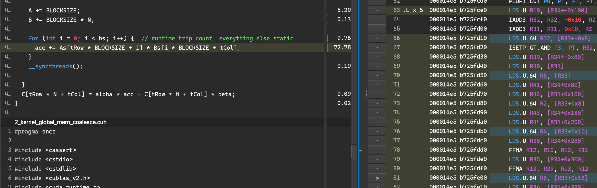

So it uses `LDS.U.64` instructions! Why not `LDS.U.128`? I don't know. But that explains
the difference in the requests total.

#### A misaligned `As` row breaks vectorization

To nail down the alignment assumption, I ran 3 more versions of k25,
changing the size of `As` so that its number of columns is not such a nice
power of 2 as `BLOCKSIZE`, to see if it breaks things as expected.
The used values are:

- `STRIDE=33` -- an odd number, should completely break alignment
- `STRIDE=34` -- even number, but not a multiple of 4 -- `LDS.128` shouldn't be
  possible, but `LDS.64` still should.
- `STRIDE=36` -- a multiple of 4, but not a power of 2 as in the original.
  To exclude any power of 2 magic.

|                       |       |          |           |
| --------------------- | ----- | -------- | --------- |
| `As` STRIDE           | 33    | 34       | 36        |
| duration, ms          | 430   | 338      | 329       |
| `As` load instruction | `LDS` | `LDS.64` | `LDS.128` |

As expected, the times fell into the same performance bins as their counterparts:

|              |             |                |                 |
| ------------ | ----------- | -------------- | --------------- |
| kernel       | k30 (`LDS`) | k31 (`LDS.64`) | k25 (`LDS.128`) |
| duration, ms | 447         | 345            | 323             |

---

Another puzzling thing is that despite the number of requests to SMEM being
significantly higher for k31 vs k25 (3.22 G vs 2.68 G) performance stays roughly on
par: 345 ms vs 323 ms. How can this be? The reason is that requests
don't necessarily measure the same amount of work. This is where the concept
of a wavefront comes in handy again. Let's dig into the 'Memory Workload
Analysis/Memory tables' section to see how many wavefronts those requests generated
for our kernels:

| kernel | Requests   | Wavefronts |
| ------ | ---------- | ---------- |
| k23    | 4295491584 | 4295491584 |
| k25    | 2684354560 | 3221225472 |
| k30    | 4294967296 | 4294967296 |
| k31    | 3221225472 | 3221225472 |

(k23 - global loads, k25, k30 and k31 - shared loads).

So we see that k25 is the only kernel for which the number of requests doesn't
match the number of wavefronts. Likely, what happens here is that `LDS.U.128`
is translated into 2 wavefronts, while `LDS.U.64` - into 1. Using the same
arithmetic, but with 1.25 and 1.5 LDS/iteration instead of 2 we get exactly
2.68 G and 3.22 G requests. Note that the wavefronts number matches the
kernels' performance: k25 is on par with k31, while k23 is similar to k30.

##### K25's conclusion

What did we learn from this deep dive? I guess I can boil it down to the following:

1. Shared memory blocking didn't speed up the kernel through data reuse. With
   scalar `LDS` loads from shared memory it is as slow as k23. The gain comes
   from the compiler's vectorized `LDS.128` loads of `As`, which cut the number
   of wavefronts, and the compiler can only emit them when it can prove the
   rows are aligned.
2. Looking at SASS alongside the metrics can provide valuable insights into the
   kernel's performance. And sometimes it's the only way.
3. Sometimes a better kernel means worse metrics. The kernel stalls about 2x
   longer per instruction (41.36 vs 19.52 cycles) but executes about 3x fewer
   instructions (6G vs 17.7G), which nets out to the 1.4x speedup.

## 1D blocktiling: attacking the MIO

We saw that the shared memory pipeline (MIO) is still the main stall reason for
k25. The next kernel's optimization is pointed directly at this: we increase
the arithmetic intensity of the kernel by going from computing a single output
element per thread to computing multiple. This should reduce the pressure on
the shared memory due to the better data reuse: every element loaded from SMEM
now feeds several FMAs instead of one.

And that indeed holds!
Kernel duration improved to 145 ms. We also see far fewer requests to SMEM
(805 306 368 for the Shared Load with 1 342 177 280 wavefronts).

Instruction statistics for the first time show floating point operations as
the most prominent type:

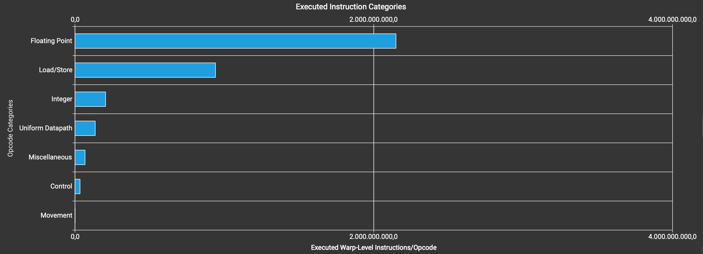

MIO throttle is still the leading cause of stalls, but the metrics are much
better: 6.02 cycles out of 15.68 cycles in total Warp Cycles Per Issued
Instruction. It hints towards the next optimization: easing the shared memory load
even further with 2D blocktiling.

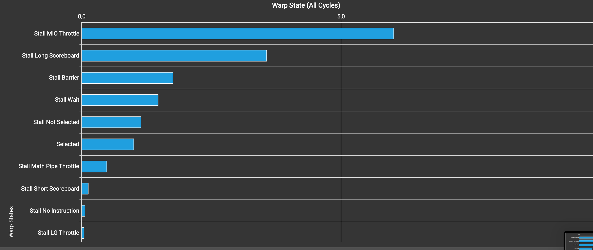

> [!NOTE]
> In his post Boehm suggests that `Bs` is loaded with `LDS.128`
> instructions. That's a mixup! In reality it's As that's wide-loaded, as we saw
> before when we zoomed in on k25's performance and SASS. It also suggests that
> it's fine to read As non-contiguously in the inner loop: the compiler recognizes
> that we read the whole BK \* TM chunk in two nested loops and optimizes the
> loads for us.

Another notable thing is that occupancy dropped to 50% because of the registers
limit. I tried increasing it back to 100% by compiling with `-maxrregcount=64`,
which indeed raised the occupancy, but the duration stayed roughly the same:
147 ms. Possibly what happens is we're still being limited by the shared memory,
so adding more warps simply means longer queues.

## 2D blocktiling: performance gains and bank conflicts

Continuing the improvement on that same shared memory access path, the 2D
blocktiling kernel brings the duration further down to 74.4 ms -- a 2x
improvement, like in the original post.

We also see much better arithmetic pipe utilization (blue: k27, green: k26):

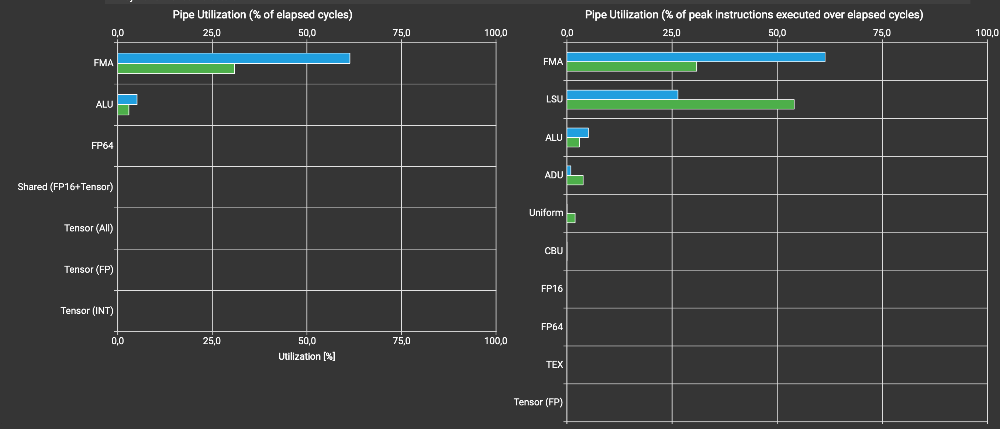

We also see the increased utilization of L1 cache again: the hit rate for k27
sits at 18.8% vs 0.77% for k26. How can the cache be utilized if we only load each
element once?
This is likely caused by loading of the matrix C from the global memory.
Remember the sectors/request story from the naive kernel diagnosis? Let's consider
how we load `C`:

```cpp
for (int iTM = 0; iTM < TM; ++iTM) {
  for (int iTN = 0; iTN < TN; ++iTN) {
    index = (tRow * TM + iTM) * N + tCol * TN + iTN;
    C[index] = alpha * threadResults[iTM * TN + iTN] + beta * C[index];
  }
}
```

What happens here is not dissimilar to k21. Global memory is read in 32-byte
sectors. Because the elements we load within the same warp (indexed by `tCol`)
are non-contiguous in memory, each 32-byte sector contains both the data we've
just asked for and the neighbouring elements we don't need yet. We can indirectly
confirm this by looking at sectors/request statistics for L1. For k27 we see this
value to be 4.37. Let's see if the napkin math agrees:

```txt
Setup
  M = N = K = 4096
  BM = BN = 128,  BK = TM = TN = 8
  blocks  = (M / BM) * (N / BN)  = 32 * 32 = 1024 = 2^10
  K-steps = K / BK               = 512          = 2^9

Tile loads (A and B, global -> shared)
  per K-step a block loads BM * BK = 1024 floats of A and BK * BN = 1024 of B
  one warp request covers 32 floats -> 32 requests for A + 32 for B = 2^6
  requests = 2^10 blocks * 2^9 steps * 2^6 = 2^25
  sectors  = 2^25 * 4                      = 2^27   (4 sectors/request: fully coalesced)

C loads (epilogue)
  one warp request per 32 elements of C
  requests = M * N / 32  = 2^19
  sectors  = 2^19 * 32   = 2^24                (32 sectors/request: a sector per thread)

Average
  (2^27 + 2^24) / (2^25 + 2^19) = (2^8 + 2^5) / (2^6 + 1) = 288 / 65 = 4.4308
```

So we get estimated 4.43 vs 4.37 measured sectors/request. I say close enough:)

Now, to get that L1 hit rate we need to mention a few things:

1. L1 hit rate considers accessed sectors, not requests
2. Both loads and stores are accounted; stores are always counted as hits
3. The miss rate for C loads is 1 out of 8. Each thread owns a block of
   `TN = 8` adjacent floats in a row of C, and since an L1 sector is 32 bytes,
   that block is exactly one sector. With `iTN = 0` each thread loads the first
   float of its block: a miss that brings in the whole sector. The loads for
   `iTN = 1..7` read the same sector again and hit.
4. Tile loads always miss cache -- we always load unique elements from A and B.

<!-- TODO: add a diagram for point 3 -->

Having that in mind, here's what we get for the napkin L1 hit rate:

```txt
Sectors
  C loads  = 2^24,  of which hits = 2^24 * 7/8
  C stores = 2^24,  all counted as hits
  tiles    = 2^27,  no hits

Hit rate
  (2^24 * 7/8 + 2^24) / (2^27 + 2^24 + 2^24) = (7/8 + 1) / (8 + 1 + 1) = 0.1875
```

So, 18.75% napkin vs 18.8% measured. Pretty cool! That being said, the number
of requests to load and store C is still tiny compared to the tile loads
(`2^19` vs `2^25`), and those are only the GMEM loads -- most of the work is
still loading from SMEM. So it doesn't affect performance. It's just nice to
see how we can reason about some of these metrics even when they're puzzling at
first.

Let's get back to things that are actually crucial for the kernel performance.

Shared memory requests are down to 167772160 (-79.17% vs k26) and the
wavefronts - to 738197504 (-45.00% vs k26). Interestingly, for the first time we see bank
conflicts on the shared loads, 301 989 888 in total.
This will be the main theme of the final kernel, so let's see where they come from.

Bank conflicts can be examined on a per-line basis in the "Source" tab:

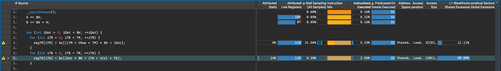

The metric that shows the bank conflicts is called "L1 Wavefronts Shared Excessive".
Excessive wavefronts are indeed what results from the bank conflicts: whenever
a conflict occurs, the work is split into non-conflicting parts and queued up.

We see that the line `regTN[iTN] = Bs[iDot * BN + iTN + tCol * TN];` is
responsible for 88.88% of the total excessive wavefronts (the remaining 11.11% is
attributed to the line `regTM[iTM] = As[(iTM + tRow * TM) * BK + iDot];`, but
let's focus on `Bs` - the reasoning is similar.)


To figure out what's conflicting we need to see what indices a single warp
produces, modulo the number of banks (32). Let's say `iDot` and `iTN` are 0.
With `TN=8` we have `(tCol * TN) % 32 = 8 * (tCol % 4)`,
so we only access 4 different banks out of 32 here. Let's remember this,
we'll come back to it very soon.

Let's look further at SASS for the shared memory load instructions. Here's a
surprise: for loading `As` we see the mixture of `LDS` and `LDS.128`.

```cpp
for (int iDot = 0; iDot < BK; ++iDot) {
  for (int iTM = 0; iTM < TM; ++iTM) {
    regTM[iTM] = As[(iTM + tRow * TM) * BK + iDot];
  }
  ...
}
```

The SASS below shows the load instructions highlighted by the profiler for
`regTM[iTM] = As[(iTM + tRow * TM) * BK + iDot];`. The lines are again grouped
and annotated by Claude:

```asm
// As row = BK floats = 0x20 bytes; R6 points at the thread's first row (tRow * TM)

// 8 x LDS: iDot = 0 of each row
LDS.U     R104, [R6.X4]          // row 0
LDS.U     R38,  [R6.X4+0x20]     // row 1
LDS.U     R120, [R6.X4+0x40]     // row 2
LDS.U     R20,  [R6.X4+0x60]     // row 3
LDS.U     R34,  [R6.X4+0x80]     // row 4
LDS.U     R32,  [R6.X4+0xa0]     // row 5
LDS.U     R31,  [R6.X4+0xc0]     // row 6
LDS.U     R29,  [R6.X4+0xe0]     // row 7

// 8 x LDS.128: iDot = 0..3 of each row (iDot = 0 loaded again)
LDS.U.128 R52, [R6.X4]           // row 0
LDS.U.128 R48, [R6.X4+0x20]      // row 1
LDS.U.128 R44, [R6.X4+0x40]      // row 2
LDS.U.128 R40, [R6.X4+0x60]      // row 3
LDS.U.128 R36, [R6.X4+0x80]      // row 4
LDS.U.128 R32, [R6.X4+0xa0]      // row 5
LDS.U.128 R28, [R6.X4+0xc0]      // row 6
LDS.U.128 R16, [R6.X4+0xe0]      // row 7

// 8 x LDS.128: iDot = 4..7 of each row
LDS.U.128 R24, [R6.X4+0x10]      // row 0
LDS.U.128 R52, [R6.X4+0x30]      // row 1
LDS.U.128 R44, [R6.X4+0x50]      // row 2
LDS.U.128 R36, [R6.X4+0x70]      // row 3
LDS.U.128 R32, [R6.X4+0x90]      // row 4
LDS.U.128 R48, [R6.X4+0xb0]      // row 5
LDS.U.128 R40, [R6.X4+0xd0]      // row 6
LDS.U.128 R56, [R6.X4+0xf0]      // row 7
```

Something funky is going on there: most of the data are already loaded with
`LDS.128`. Likely, the compiler again is able to reason about both `iDot` and
`iTM` loops at the same time and figure out the wide loads are possible.

As expected, the `Bs` loading loop (below) uses `LDS.128` everywhere. 'As expected'
because the fast variable iterates over the contiguous bytes.

```cpp
for (int iTN = 0; iTN < TN; ++iTN) {
  regTN[iTN] = Bs[iDot * BN + iTN + tCol * TN];
}
```

And the most important part, the warp stalls are significantly reduced, but MIO
Throttle remains the main warp stalling factor:

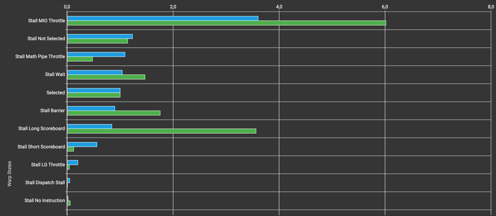

## SMEM and GMEM optimization kernel: less of an issue than it appears

The next kernel in the ladder aims to optimize the memory access by manually
forcing those wide loads that we already saw the compiler using when the conditions
are right.

In the k27 section we saw that most of the `As` loads are already
in the wide `LDS.128` form, so it's not a big surprise that this kernel is
only marginally faster than the previous one with a 6.91% speedup down to 69.3 ms.

Inspecting SASS for it confirms that all of the load instructions for As are now
vectorized, as well as the global loads: we see `LDS.128` and `LDG.128`
respectively. For `float4 tmp = reinterpret_cast<float4 *>(&A[innerRowA * K +
innerColA * 4])[0];` we have (no loop unrolling):

```asm
MOV R40, UR6
MOV R41, UR7
IMAD R25, R86, c[0x0][0x168], R25
IMAD.WIDE.U32 R40, R25, 0x4, R40
LDG.E.128.SYS R40, [R40]
```

And for `regTM[iTM] = As[iDot * BM + tRow * TM + iTM];` the instructions
are scattered and interleaved with those for the other lines, but all of the
`LDS` ones appear in the `LDS.U.128` form.

Our most important metric so far, the MIO Throttle stall, is down by 6% to 3.39
and is still the main stall reason (see the figure below).
Shared-load requests drop by 20% (168M → 134M) but wavefronts only by 9% (738M
→ 671M). Note the correlation with the speedup of 6.91%.

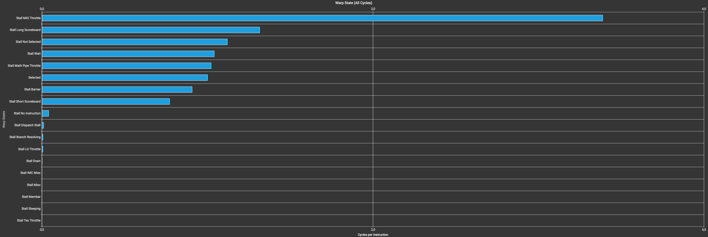

Coming back to the bank conflicts, for the shared loads those are down by 11%,
but 16777216 new shared store conflicts were introduced. The lines
responsible are the same, except the `As` stores are now split:

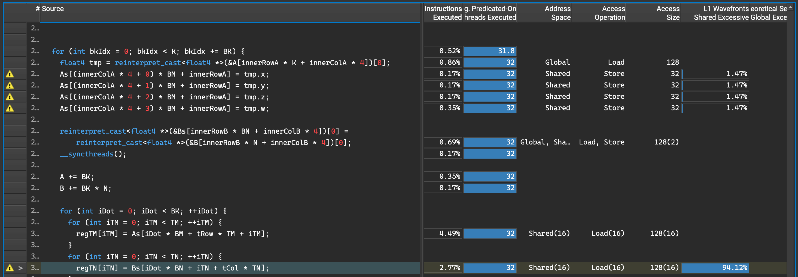

So, since the MIO throttle is still the main issue, the bank conflicts look
like an obvious next target to tackle it.

But first, let's napkin-math the number of shared-load wavefronts and see if we
can arrive at the measured 671088640. I'll count per warp per K-tile and
multiply by the number of warps and K-tiles at the end. Recall that with 256
threads per block, `tRow = threadIdx.x / 16` and `tCol = threadIdx.x % 16`, so
a warp holds two values of `tRow`, each with `tCol` running from 0 to 15.

First, for `regTM[iTM] = As[iDot * BM + tRow * TM + iTM];`. Each thread loads
`TM = 8` floats per `iDot` with 2 `LDS.128` instructions, so it's 16 instructions
per K-tile (`BK = 8` iterations of iDot). Within one instruction, the 16 lanes of
one `tRow` all read the same `float4` (a broadcast), and the other 16 lanes
read another `float4` 8 floats further. That's 8 different floats in 8
different banks, so one wavefront should be enough. But we saw in k25 that a
broadcast `LDS.128` resolvs into 2 wavefronts (the reason being unclear), so
let's assume 2 here as well. That's `16 * 2 = 32` wavefronts per warp per
K-tile.

Now, for `regTN[iTN] = Bs[iDot * BN + iTN + tCol * TN];` we again have 16
`LDS.128` instructions per K-tile, but they are not broadcasts: `tCol` is the
fast index, so the 16 values of `tCol` ask for 16 different `float4`s (the second
`tRow` asks for the same ones). We saw for k27 that for a fixed `iTN` this index
taps into only 4 different banks. A wide load covers 4 consecutive `iTN`, so
each instruction uses 16 banks, with 4 different floats in each:

```
bank     0-3   4-7   8-11  12-15  16-19  20-23  24-27  28-31
tCol     0     -     1     -      2      -      3      -
         4     -     5     -      6      -      7      -
         8     -     9     -      10     -      11     -
         12    -     13    -      14     -      15     -
```

A bank delivers one float per wavefront, so it takes at least 4 wavefronts per
instruction. On top of that come the bank conflicts: NCU reports 268435456 of
them for the shared loads, all on the `Bs` line. Spread over
`16 * 512 * 8192` `Bs` instructions, that's 4 extra wavefronts per instruction,
so 8 in total, and `16 * 8 = 128` wavefronts per warp per K-tile.

In total, we get 32 + 128 = 160 wavefronts per warp per K-tile. With
4096² / 64 / 32 = 8192 warps and K / BK = 512 K-tiles that's
160 × 512 × 8192 = 671088640, exactly the measured number, which also confirms
the 2 wavefronts per `As` instruction. The 268435456 conflict wavefronts are
what we're going after next.

One important observation from this math: a wavefront reads at most 32 floats,
one per bank. So when a warp needs 32 different floats from 32 different banks,
a scalar `LDS` already gets them in one wavefront, and vectorization can't
reduce the number of wavefronts, only the number of instructions.

## Topple the throttle

Solving the bank conflicts didn't do much for Boehm apart from making the
kernels slower on his A6000. In my experiments on a T4, however, resolving the
bank conflicts resulted in a significant boost from 69.3 down to 60.62 ms.

We see from the Memory Workload Analysis section that the shared load bank
conflicts are gone (shared store bank conflicts at the same time are up by 100%
-- to 33554432). And for the first time we see that SMEM is not the main cause
of the warp stalls! MIO throttle at 1.3 cycles subsided to "Stall Not Selected"
with 1.88 cycles out of 8 warp cycles per issued instruction:

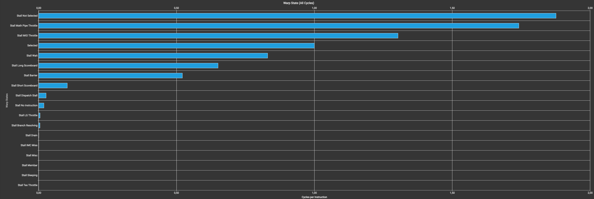

Regarding the bank conflicts themselves, we see from the "Memory Workload
Analysis / Shared Memory" tables that for the shared loads they are gone
completely:

|                    | ... | Bank Conflicts       |
| ------------------ | --- | -------------------- |
| Shared Load        | ... | **0 (-100%)**        |
| Shared Load Matrix | ... |                      |
| Shared Store       | ... | **33554432 (+100%)** |
| Shared Atomic      | ... | 0 (+0%)              |
| Other              | ... | 0 (+0%)              |
| **Total**          | ... | 33554432 (-88.24%)   |

At the same time, the Shared Store conflicts are up by 100%. Shared storeas are not
the problem however: those are the minority (total is down by 88%) and we're no longer
bottlenecked by the shared memory (MIO is not the top warp stall).

For curiosity let's look at "L1 Wavefronts Shared Excessive" metric to see
where the store load conflicts orignate from:

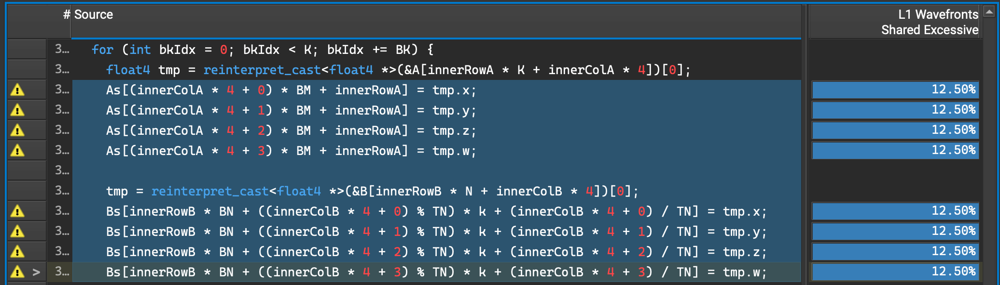
 
We see that they are now equally split between the lines loading `As` and `Bs`
into the shared memory.

The number of Shared Memory Load requests is up by 150% to 335544320, but
the wavefronts number is actually down by 40%: 402653184. Let's again napkin-math it.


- The ultimate limit we should hit for an optimal kernel is the FMA pipeline.
  For k29 it's at 74.42% utilization, suggesting another 25% duration cut should
  be theoretically possible.

> [!NOTE]
> "Stall Not Selected" means that the warp was ready, but another warp was
> selected instead. It's not really a stall. [Nvidia docs on
> this](https://docs.nvidia.com/nsight-compute/ProfilingGuide/index.html#warp-stall-reasons)

## Conclusion

## Numbers

| Kernel            | Duration, ms | Shared load requests | Wavefronts    | Load conflicts | Top stall (cycles of total) | FMA pipe |
| ----------------- | ------------ | -------------------- | ------------- | -------------- | --------------------------- | -------- |
| 21 naive          | 5910         | –                    | –             | –              | LG Throttle 236 of 250.39   | 2.65%    |
| 23 coalesced      | 451          | –                    | –             | –              | LG Throttle 10.4 of 19.52   | 37.14%   |
| 25 shared mem     | 323          | 2,684,354,560        | 3,221,225,472 | 0              | MIO Throttle 26.72 of 41.36 | 13.87%   |
| 26 1D tiling      | 145          | 805,306,368          | 1,342,177,280 | 0              | MIO Throttle 6.02 of 15.68  | 30.86%   |
| 27 2D tiling      | 74.4         | 167,772,160          | 738,197,504   | 301,989,888    | MIO Throttle 3.6 of 10.55   | 61.38%   |
| 28 vectorized     | 69.3         | 134,217,728          | 671,088,640   | 268,435,456    | MIO Throttle 3.39 of 10.63  | 65.21%   |
| 29 bank conflicts | 60.62        | 335,544,320          | 402,653,184   | 0              | Not Selected 1.88 of 8      | 74.42%   |

- L1/TEX hit rate: 97.33% (k21), 94.98% (k23)
- Benchmark binary, no profiler: 36 ms (k29), 34 ms (cuBLAS)

## Wavefronts vs requests significance for the kernel performance

| Kernel | Duration, ms | Wavefronts, M | ms per M wavefronts |
| ------ | ------------ | ------------- | ------------------- |
| k23    | 451.9        | 4295          | 0.105               |
| k30    | 447.1        | 4295          | 0.104               |
| k25    | 323.2        | 3221          | 0.100               |
| k31    | 345.9        | 3221          | 0.107               |
| k26    | 145          | 1342          | 0.108               |
| k27    | 74.4         | 738           | 0.101               |
| k28    | 69.3         | 671           | 0.103               |
| k29    | 60.6         | 403           | 0.151               |

## References

[Nvidia ref](https://developer.nvidia.com/blog/analysis-driven-optimization-preparing-for-analysis-with-nvidia-nsight-compute-part-1/)
