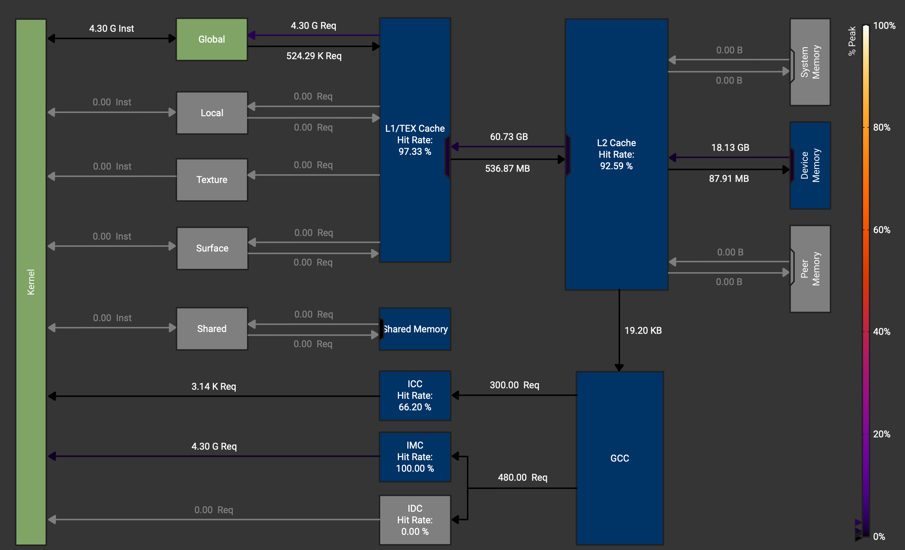
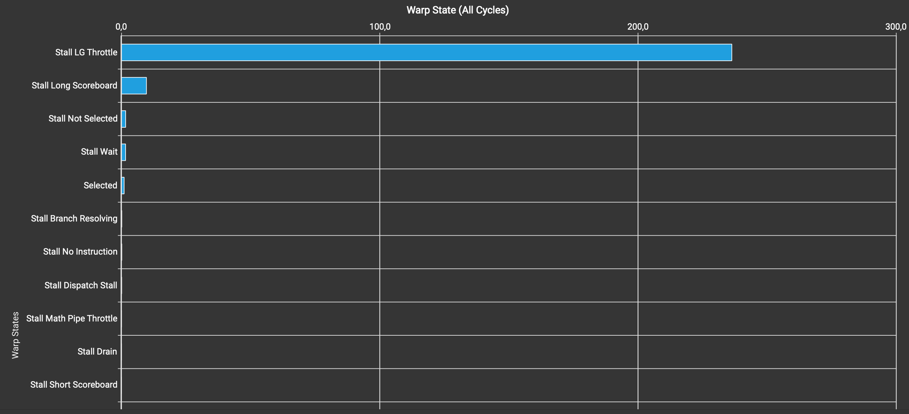
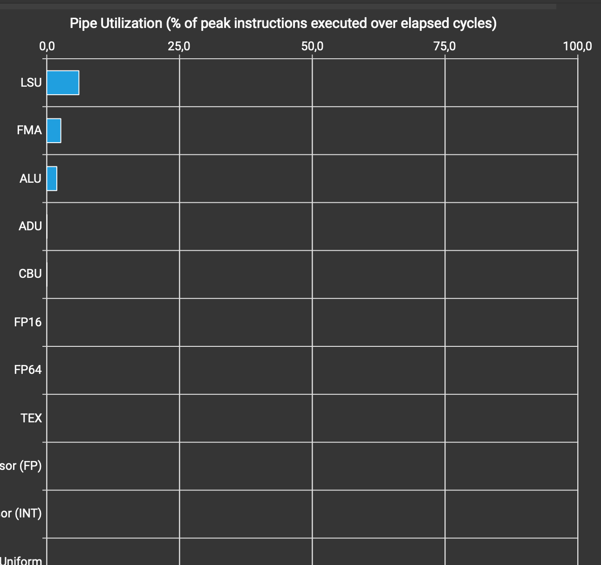

# The what and why

Recently I embarked on a journey of learning the inside-outs of the ML models
machinery. One corner of it that especifically drew my attention is the CUDA
programming -- tooling that powers those fast matrix multiplications, that make
the modern AI possible in the first place. And since I think the best way to
learn a thing is to build it yourself, I decided to lockstep [Boehm's excellent
worklog](https://siboehm.com/articles/22/CUDA-MMM) on coding a matrix
multiplication kernel performing at about 94% of the CuBLAS.

This post is my account of re-implementing large chunk of the ladder, but more in
the
[analysis-driven](https://developer.nvidia.com/blog/analysis-driven-optimization-preparing-for-analysis-with-nvidia-nsight-compute-part-1/)
fashion: I profile each intermediate kernel to see, if the numbers pave the
same path as the original worklog suggests, while learning the tooling in the process.

In the end, I reach similar 94% of CuBLAS performance, albeit with a different
kernel (makes sense, I uses T4 GPU vs Boehm's A6000). Most importantly though,
using the profiler revealed that the textbook story about the data locality and
optimizing the off-chip memory usage appears to be over-simplified and somewhat
misleading: the L1 cache absorbst most of the hit for the DRAM access, and the
real story behind some of the performance gains actually involves the on-chip
optimizations.

More generally, I once again confirmed for myself that closing the feedback
loop with the proper tooling when doing the performance optimizations is very
important and sometimes the story we tell ourselves about how something works
can lead us astray.

## The setup: Colab + local profiling info analysis

To climb the ladder I used the following setup:

- Clone Boehm's repo, code my kernels alongside of his, use his harness to
  evaluate
- Use Google Colab for the GPU access:
  - It's free
  - It adds the profiling information (not all platforms do)
- The GPU is used on Colab is one of the default ones: Nvidia T4
- For the profiling info analysis I used a split setup:
  - run the NCU profiler on the Colab cloud machine
  - download the profiler's reports
  - analyze them locally using the NCU UI
- I used a single matrix size to profile to save time: 4096x4096
- The durations I report below are the ones from the NCU profiler, so they contain
  significant profiling overhead and should only be judged in comparison, not as
  absolute numbers.
- I analyzed the profiling metrics together with Claude Code constantly
  cross-checking my understanding of what's going on.

### On the profiler setup

Nvidia has an exellent profiler for analyzing the kernel's performance,
[NCU](https://developer.nvidia.com/tools-overview/nsight-compute/get-started).
It supports both a CLI and a graphical UI, and I leaned at first towards using the
CLI for three reasons:

- it's the most straightforward in the cloud-based setup (I run the kernel in Colab)
- it's easier to integrate with the AI tooling
- I find it easier in general to deal with the terminal tools than with UIs

However, NCU has a lot of metrics, some of which are quite complex and I
quickly realized that using a GUI provides some crucial benefits, especially
for someone who's learning:

- it represents the data visually, so it's easier to digest, especially with
  things like the baseline comparison, which allows you to compare the kernels
  among each other
- with all the data gathered in one place and easy to navigate to it makes
  discoverabilty much less of an issue, which is a huge deal for someone who's
  learning what tools and techiniques are available for the first time.

Below is the code I used in the Colab notebook to run the profiler.

Cloning and building the repo:

```sh
%%bash

rm -rf sgemm
git clone https://github.com/dmalt/SGEMM_CUDA.git sgemm && cd sgemm
cmake -S . -B build -DCMAKE_BUILD_TYPE=Release -DCMAKE_CUDA_FLAGS="--generate-line-info"
cmake --build build --parallel
```

Notice the `--generate-line-info` flag -- we need it to tie the CUDA kernel
code lines to the generated assembly for the later analysis.

Then run the following to profile the kernels:

```sh
# Running the profiler
while read -r id name; do
  echo "-------- $id $name ------- "
  ncu --set full \
      -o "k${id}_full" --force-overwrite \
      --kernel-name "regex:${name}" \
      --launch-skip 10 --launch-count 1 \
      ./sgemm/build/sgemm "$id"
done <<'EOF'
21 sgemm_naive_dmalt
23 sgemm_coalesce_dmalt
25 sgemm_shared_mem_block_dmalt
26 sgemm1DBlocktilingDmalt
27 sgemm2DBlocktilingDmalt
28 sgemmVectorizeDmalt
29 sgemmResolveBankConflictsDmalt
EOF

zip reports.zip k*_full.ncu-rep
```

## The naive kernel: diagnosing memory coalescing issues with sectors/request

Running the naive kernel took 2.25 seconds on the T4 (Boehm's A6000 produced 0.5s for comparison) -- very slow, no suprises there. As explained by the original post,
assuming zero caching we load 548 GB from DRAM. In addition, the access pattern
for matrix `A` is not ideal: we load the elements that are placed in memory non-contiguously.

Let's look at the metrics to see, if that explanation holds. Below is the table from the Speed Of Light section in NCU:

| Metric                      | Value | Metric                   |         Value |
| --------------------------- | ----: | ------------------------ | ------------: |
| Compute (SM) Throughput [%] |  6.05 | Duration [s]             |          5.91 |
| Memory Throughput [%]       | 49.95 | Elapsed Cycles [cycle]   |    3548921497 |
| L1/TEX Cache Throughput [%] | 99.90 | SM Active Cycles [cycle] | 3543970101.57 |
| L2 Cache Throughput [%]     |  1.22 | SM Frequency [Mhz]       |        600.00 |
| DRAM Throughput [%]         |  0.96 | DRAM Frequency [Ghz]     |          5.00 |

Note that the NCU-reported duration is much higher than 2.25 seconds coming
from the Boehm's profiling harness. That's the effect of the mentioned
profiling overhead.

One thing that immediately catches the eye is that the kernel sits at 99.9% L1/TEX cache throughput.
Let's take a look at the Memory Chart from the 'Memory Workload Analysis' section:



We see that the total hit rate for L1 is at 97.33%, so Most of the GMEM
accesses actually do get cached! Overall we load 18.13GB of traffic from GMEM
to the on-chip memory, which is very significant, but nowhere near the
potential 548 GB maximum.

Another thing to notice is that the DRAM throughput of mere 0.96%. The global
memory pipeline is barely doing anything! It tells us that those 18GB of global
memory traffic are not really the bottleneck.

The answer hides in one of the NCU optimization suggestion:

> On average, each warp of this workload spends 236.3 cycles being stalled
> waiting for the L1 instruction queue for local and global (LG) memory
> operations to be not full. Typically, this stall occurs only when executing
> local or global memory instructions extremely frequently. Avoid redundant
> global memory accesses. Try to avoid using thread-local memory by checking if
> dynamically indexed arrays are declared in local scope, or if the kernel has
> excessive register pressure causing spills. If applicable, consider combining
> multiple lower-width memory operations into fewer wider memory operations and
> try interleaving memory operations and math instructions. This stall type
> represents about 94.4% of the total average of 250.4 cycles between issuing
> two instructions.

Let's take a look at the Warp State Statistics for the naive kernel:



We see that same 236 out of 250 cycles figure for the 'Stall LG Throttle'.
What's 'LG Throttle'? To quote Nvidia Developer blog on this, it's

> ... “average # of warps resident per issue cycle, waiting for a free entry in the
> LSU instruction queue”. LSU is Load/Store Unit, one of the functional units in
> a GPU SM.

So the warps are stalled waiting for the LSU pipeline. This pipeline is the one
that's responsible for the requests to L1. Let's check the Compute Workload
Analysis section, which reports utilization of the pipes, including LSU:



It sits at mere 6.05%. Same number as we saw in the SOL table above for the
Compute Throughput. The reason being Compute Throughput is the aggregate metric - it
reports maximum among several other metrics, which LSU is one of.

But the important part is that LSU is nowhere near saturation. So it's not like
we make too many requests to the LSU. But it's the one we're waiting for. What
does it mean? Should be obvious, but it wasn't for me at the time. It means
that we don't use it efficiently. And there's another metric pointing at this.

If we look at the "Memory Workload Analysis" section and switch from 'Memory Chart'
to 'Memory Tables' in the dropdown next to the section title, we'll see a whole bunch
of stats in the L1/TEX Cache section. We're interested in the column called
'sectors/request'. For the 'Global Load' section it reads '16.5'. This is very high!

To see why, we need to understand what's a sector and how a good memory access
pattern should look like. When we fetch the data on L1, the the access is
structured in 32 bytes blocks (or 8 fp32 numbers), called sectors. Instructions
to load the data from the memory are organized per-warp, so for 32 lanes in
warp we are requesting 32 floating point numbers from L1. If these numbers are
contiguous in memory, we would touch 4 sectors to access 32 numbers. If they
are not, however, we would touch up to 32 sectors in the worst case. And whenever
we touch a sector on L1, the whole sector gets moved. So in our case of average
16.5 sectors per request we effectively touch 4.125 times more data than needed.
This is the manifestation of the uncoalesced memory access mentioned in the
Boehm's longread.

Let's see, where this number comes from. Here's how we multiply a row of A by a column
of B:

```cpp
const uint x = blockIdx.x * blockDim.x + threadIdx.x;
const uint y = blockIdx.y * blockDim.y + threadIdx.y;
...
for (int i = 0; i < K; i++) {
  acc += A[x * K + i] * B[i * N + y];
}
```

For `A[x * K + i]`, lanes in a warp, following the `x` index, access the elements of
the row-major matrix A in a column-major fashion, so each of the 32 accesses touches
a unique sector, 32 sectors in total. Then, for `B[i * N + y]`, `y` is slow-varying,
so the index is the same for each lane in the warp -- each lane loads the same
element, resulting in a broadcast access pattern: 1 sector/request. On average we
get `(32 + 1)/2 = 16.5` sectors/request.

So what happens is because of the uncoalesced memory access every request loading
elements of matrix A touches 8x data it needs to causing every request to be slow,
hence the low LSU throughput clogging up everything downstream.

Coming back to the L1/TEX cache throughput of 99.9%. It's also the aggregate metric
and, to tie it back to the sectors/requests I looked into what it's composed of and
what is the primary limiting one it can be done similar to this:

```sh
ncu --metrics breakdown:l1tex__throughput.avg.pct_of_peak_sustained_active \
    --kernel-name regex:sgemm_naive_dmalt --launch-count 1 \
    ./sgemm 21
```

The output I got was as follows:

```txt
 Section: Command line profiler metrics
 -------------------------------------------------------------------------- ----------- ------------
 Metric Name                                                                Metric Unit Metric Value
 -------------------------------------------------------------------------- ----------- ------------
 ...
 tpc__l1tex_data_pipe_lsu_wavefronts.avg.pct_of_peak_sustained_active                 %        99.90
 ...
 -------------------------------------------------------------------------- ----------- ------------

```

So the actual metric that's at 99.9% is
`tpc__l1tex_data_pipe_lsu_wavefronts.avg.pct_of_peak_sustained_active` and it
measures the LSU pipeline utilization inside the L1 unit. As you see, it all agrees
with the LG Throttle we saw from the Warp State Statistics.

Note that the metric mentions 'wavefronts'. Let's use this as excuse to define
wavefronts here since they'll play an important role later.

> Wavefront is a unique "work package" generated at the end of the processing
> stage for requests.

Importantly, when a warp generates a request, each request means at least one
wavefront, but the opposite is not necessarily true -- one request can also
translate into multiple wavefronts.

Back to our busyness. To conclude, the detailed metrics-grounded breakdown of
what happens is as follows.

- We try to load way too much from GMEM
- Most of the GMEM traffic gets cached in L1
- However, we access the cached elements of matrix A in an uncoalesced manner.
- This leads to a high number of sectors/request accessed.
- This in turn generates an elevated number of wavefronts
- The wavefronts flood the LSU unit inside L1, causing the 99.9% utilization and
  very long warp stalls.

Or at least I think that's what happens: some of things, like how sectors/requests translate
into the wavefronts I can't directly ascertain.

## The coalesced kernel: identifying L1 as the bottleneck with the warp state statistics

## Shared memory blocking: shifting the bottleneck how the intuition fails us

- Global memory access patterns are not the issue
- Looking into SASS
- Experiments with breaking the compiler optimizations
- Wavefronts vs requests significance for the kernel performance

## 1D blocktiling: attacking the MIO throttle

## 2D blocktiling: performance gains and bank conflicts

## SMEM and GMEM optimization kernel: less of an issue than it appears

## Dealing with bank conflicts to finally topple the MIO throttle

## Conclusion

## Numbers

| Kernel            | Duration, ms | Shared load requests | Wavefronts    | Load conflicts | Top stall (cycles of total) | FMA pipe |
| ----------------- | ------------ | -------------------- | ------------- | -------------- | --------------------------- | -------- |
| 21 naive          | 5910         | –                    | –             | –              | LG Throttle 236 of 250.39   | 2.65%    |
| 23 coalesced      | 451          | –                    | –             | –              | LG Throttle 10.4 of 19.52   | 37.14%   |
| 25 shared mem     | 323          | 2,684,354,560        | 3,221,225,472 | 0              | MIO Throttle 26.72 of 41.36 | 13.87%   |
| 26 1D tiling      | 145          | 805,306,368          | 1,342,177,280 | 0              | MIO Throttle 6.02 of 15.68  | 30.86%   |
| 27 2D tiling      | 74.4         | 167,772,160          | 738,197,504   | 301,989,888    | MIO Throttle 3.6 of 10.55   | 61.38%   |
| 28 vectorized     | 69.3         | 134,217,728          | 671,088,640   | 268,435,456    | MIO Throttle 3.39 of 10.63  | 65.21%   |
| 29 bank conflicts | 60.62        | 335,544,320          | 402,653,184   | 0              | Not Selected 1.88 of 8      | 74.42%   |

- L1/TEX hit rate: 97.33% (k21), 94.98% (k23)
- Benchmark binary, no profiler: 36 ms (k29), 34 ms (cuBLAS)

## References

[Nvidia ref](https://developer.nvidia.com/blog/analysis-driven-optimization-preparing-for-analysis-with-nvidia-nsight-compute-part-1/)
